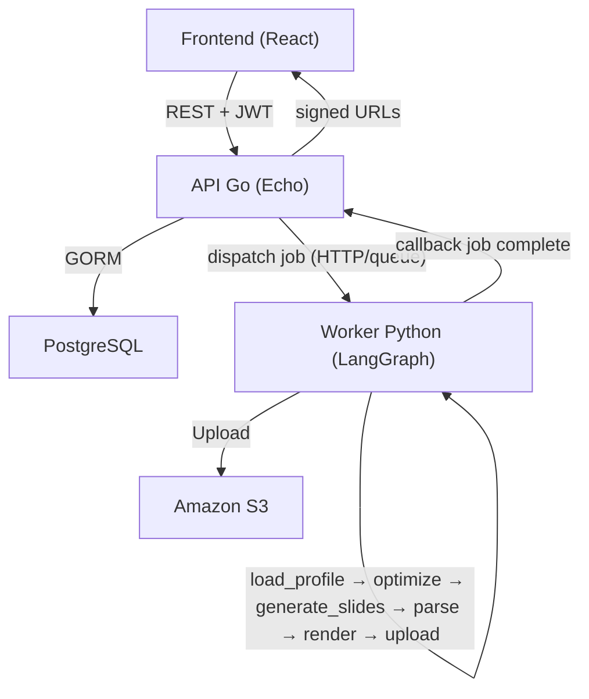

# Content Creator Agent — Design

**Spec**: `.specs/features/content-creator-agent/spec.md`
**TDD Completo**: `docs/TDD.md`
**Status**: Aprovado

---

## Architecture Overview

O sistema é uma SPA React conectada a uma **API REST em Golang/Echo** (CRUD, auth, jobs, callbacks) e a um **Worker Python (LangGraph + FastAPI)** que executa o pipeline LLM, Playwright e upload S3. O PostgreSQL persiste estado da API; o S3 armazena artefatos gerados pelo worker.



**Fluxo principal (criação de post):**

1. Usuário → prompt → Frontend
2. Frontend → `POST /chats/:id/messages` → Go
3. Go valida JWT + rate limit + sanitiza; persiste mensagem do usuário; cria `job_id`
4. Go despacha job ao Worker Python (HTTP interno ou fila)
5. Go → **`202 Accepted`** com `job_id` ao Frontend
6. Worker Python executa grafo LangGraph (perfil → otimizador → slides → parse → Playwright → S3)
7. Worker Python → `POST /internal/jobs/:job_id/complete` → Go (texto do assistente + referências S3)
8. Go persiste mensagem do assistente + imagens; atualiza status do chat/job
9. Frontend faz polling `GET /chats/:id` ou SSE → exibe slides

---

## Documentação de UI e marca (front-end)

Antes de implementar telas, ler **[`docs/ui-guidelines.md`](../../../docs/ui-guidelines.md)** — secções *Layout e padrões de UI* (estrutura, hierarquia, componentes sugeridos, UX/a11y) e *Marca e design tokens* (CSS, tipografia, sombras, resolução de conflitos entre referências).

| Screenshot | Caminho | O que extrair para este produto |
|------------|---------|----------------------------------|
| Talk Data to Me (empty + rail) | `docs/ui/version_1.png` | Rail estreita, estado ativo na nav, empty state centrado, chips de atalho, composer básico (anexo, contador, enviar) |
| Maskara.ai (thread) | `docs/ui/version_2.png` | Thread de mensagens, cards de arquivo, preview rico de conteúdo, composer com ações secundárias (ex.: voz) |
| Aplot AI (app denso) | `docs/ui/version_3.png` | Sidebar com busca/histórico, top bar com ações, feature cards, modos no composer, sombras suaves |
| CoLabs (auth) | `docs/ui/auth_1.png` | Auth em colunas: formulário claro + painel marketing escuro, inputs e CTA full-width |

**Governança:** papéis **UI Designer** e **UX Architect** → secção *Layout e padrões de UI* em `docs/ui-guidelines.md`; **Brand Guardian** → secção *Marca e design tokens* no mesmo ficheiro. Complemento opcional: [`.cursor/rules/design/design-brand-guardian.md`](../../../.cursor/rules/design/design-brand-guardian.md).

**Implementação:** mapear cores, raios, sombras e tipografia ao bloco `:root` recomendado em `docs/ui-guidelines.md` (Tailwind `theme.extend` ou variáveis CSS). Estrutura de shell (sidebar/main), thread, empty state e **ComposerBar** por slots seguem a secção de layout no mesmo documento. Estados de carregamento, erro e vazio alinham-se ao handoff em *Handoff para implementação* em `docs/ui-guidelines.md`.

**Nota:** os **JPEGs dos slides** gerados pelo worker Python são o *output* editorial; a *casca* da aplicação (login, chat, histórico) segue as referências acima — não confundir preview de slide com o shell do app.

### Engenharia de implementação (React)

Todo código front-end deste produto SHALL seguir a rule **[`engineering-frontend-developer.md`](../../../.cursor/rules/engineering/engineering-frontend-developer.md)** além de [`docs/ui-guidelines.md`](../../../docs/ui-guidelines.md). Ela é o guia normativo de **padronização e construção de código** (não substitui decisões de UI/marca já documentadas).

- TypeScript e componentes com props tipadas; estrutura de pastas e nomes alinhados ao inventário de componentes em `docs/ui-guidelines.md` quando aplicável.
- HTML semântico; ARIA e rótulos onde necessário; navegação por teclado e compatibilidade com leitores de tela (alvo WCAG 2.1 AA).
- Layout mobile-first; estados de carregamento, erro e vazio consistentes e acessíveis; feedback de erro sem expor detalhes técnicos.
- Performance: code splitting / lazy loading quando fizer sentido; atenção a bundle e assets; alinhamento às práticas da rule (Core Web Vitals quando mensurável).
- Testes: cobertura de componentes e fluxos críticos coerente com as entregas esperadas (unit/integration/E2E conforme fase do projeto).

### Engenharia de implementação (Golang / backend)

Todo código backend deste produto em `backend/` SHALL seguir a rule **[`engineering-backend-architect.md`](../../../.cursor/rules/engineering/engineering-backend-architect.md)** e a rule **[`engineering-security-engineer.md`](../../../.cursor/rules/engineering/engineering-security-engineer.md)** além deste design e de `docs/TDD.md`. São os guias normativos de **arquitetura, camadas e segurança** (não substituem endpoints e modelos já definidos na spec).

- **Backend Architect**: `cmd` / `internal`, contratos de handlers, services e repositories; GORM e migrations; integrações (S3, despacho de jobs ao worker HTTP); métricas e latência alinhadas aos Success Criteria da spec (processamento pesado no worker Python).
- **Security Engineer**: validação nas fronteiras (JSON/body, IDs); autorização e prevenção de IDOR em `/chats/:id` e arquivos; JWT (claims, refresh, rejeição de algoritmos inseguros); segredos fora de código e logs; headers HTTP, CORS e rate limiting; dependências (pinning, SBOM onde aplicável); testes alinhados à *Security Test Coverage Checklist* da rule (autenticação, autorização, input, erros sem vazamento em produção, rate limit — ver a rule para a lista completa).

---

## Code Reuse Analysis

### Componentes Existentes a Aproveitar

| Componente | Localização | Como Usar |
|------------|-------------|-----------|
| Skill `create-social-post` | `.cursor/skills/create-social-posts/SKILL.md` | Portar conteúdo para system prompts do worker Python (ler diretamente de `.cursor/` ou copiar no build) |
| Skill `map-instagram-profile` | `.cursor/skills/map-instagram-profile/SKILL.md` | Estrutura de referência para perfil; perfil enviado inline no payload do job (AUDIT/BRAND como strings) ou via URI acordada no contrato |
| Regra `prompt-engineering-meta` | `.cursor/rules/prompt-engineering-meta.mdc` | Otimização de prompts aplicada no nó `optimize_prompt` do LangGraph |

### Pontos de Integração

| Sistema | Método de Integração |
|---------|---------------------|
| OpenAI (GPT-5.4 Mini) | Cliente no **Worker Python** — chamadas nos nós LangGraph com limite de 4.000 tokens de saída (ou conforme config) |
| Amazon S3 | **Go**: AWS SDK Go v2 — Signed URLs, delete em lote, persistência de keys; **Worker**: boto3 para upload dos JPEGs gerados |
| PostgreSQL | GORM com migrations versionadas — modelos: `User`, `Chat`, `ChatContent`, `ChatContentImage`, `ChatContentResume`, **Job** (estado assíncrono) |
| Playwright/Chromium | **Worker Python** — `playwright-python` headless no container do worker (não no Dockerfile da API Go) |
| Worker Python (LangGraph) | HTTP interno: Go `POST WORKER_URL/jobs` com autenticação de serviço; worker `POST /internal/jobs/:id/complete` no Go (callback) |

### Contrato Go ↔ Python

**Entrada (Go → Worker, ex.: `POST /jobs`):**

- Identificadores: `job_id`, `user_id`, `chat_id`
- Conteúdo: `raw_message` (sanitizado)
- Perfil: inline como strings `audit_text` / `brand_text` (ou URI acordada para o worker buscar — definir na implementação)
- Metadados necessários para idempotência e correlação (headers ou body)

**Saída (Worker → Go, `POST /internal/jobs/:job_id/complete`):**

- Texto da mensagem do assistente (markdown/plain conforme produto)
- Lista de artefatos: `{ s3_key, slide_number }[]`
- Opcional: código de erro / mensagem amigável se `failed`

**Autenticação interna:** header ou secret compartilhado (`WORKER_API_KEY`) em ambas as direções; preferencialmente rede privada ou mTLS em produção.

**Idempotência:** completar o mesmo `job_id` mais de uma vez SHALL ser tratado de forma segura (no-op ou rejeição explícita conforme política documentada na API).

---

## Components

### API Layer (Golang/Echo)

- **Propósito**: Roteamento, autenticação JWT, rate limiting, validação, **despacho de jobs** para o Worker Python via HTTP (ou fila), persistência de mensagens e callbacks internos
- **Normativo**: a implementação SHALL obedecer às rules [`engineering-backend-architect.md`](../../../.cursor/rules/engineering/engineering-backend-architect.md) e [`engineering-security-engineer.md`](../../../.cursor/rules/engineering/engineering-security-engineer.md) além da estrutura e middleware listados abaixo.
- **Localização**: `backend/` — **sem** `internal/agent/` nem `internal/export/` no desenho alvo (pipeline no Python)
- **Estrutura de pacotes**:
  ```
  backend/
  ├── cmd/server/          # entrypoint main.go
  ├── internal/
  │   ├── auth/            # handlers, service, middleware JWT
  │   ├── chat/            # handlers, service, repository
  │   ├── jobs/            # criação de jobs, cliente HTTP ao worker, callback interno
  │   ├── storage/         # S3 client (signed URLs, delete)
  │   ├── db/              # GORM setup, migrations
  │   └── middleware/      # rate limit, cors, sanitize
  ├── Dockerfile           # sem Playwright/Chromium
  └── go.mod
  ```
- **Interfaces principais**:
  - `AuthHandler`: `Register`, `Login`, `Refresh`, `RecoverPassword`
  - `ChatHandler`: `List`, `Create`, `Get`, `Delete`, `SendMessage` (mensagem → job assíncrono)
  - `FileHandler`: `ListFiles`, `DownloadSingle`, `DownloadAll`
  - `InternalJobHandler`: `Complete` (`POST /internal/jobs/:id/complete`, protegido por `WORKER_API_KEY`)

### Worker Python (LangGraph)

- **Propósito**: Pipeline completo — `load_profile` → `optimize_prompt` → `generate_slides` → parse/validação → **Playwright** (JPEG 1080×1350, 4:5, qualidade 92) → **boto3** upload S3 → callback ao Go
- **Localização**: `worker/` (FastAPI + LangGraph; Dockerfile com Playwright/Chromium)
- **Interfaces**:
  - `POST /jobs`: recebe payload do Go; valida API key; dispara `graph.ainvoke` em background
  - Cliente HTTP: `POST {GO_API_URL}/internal/jobs/:job_id/complete` com texto do assistente + `{ s3_key, slide_number }[]`
- **Dependências**: OpenAI API, prompts portados dos `.md` de skills/rules (ver Code Reuse), `playwright-python`, boto3
- **Limite**: 4.000 tokens de saída por chamada LLM (ou conforme config), alinhado à spec

### Storage Service (S3)

- **Propósito**: Upload, geração de Signed URLs, download e deleção de arquivos
- **Localização**: `backend/internal/storage/`
- **Interfaces**:
  - `Upload(ctx, key, data) → error`
  - `GetSignedURL(ctx, key, expiry) → (string, error)`
  - `Delete(ctx, key) → error`
  - `DeleteMany(ctx, keys []string) → error`
- **Retry**: Backoff exponencial com 3 tentativas no upload

### Auth Middleware

- **Propósito**: Validar JWT em todas as rotas exceto `/auth/*`; extrair `user_id` e injetar no contexto da requisição
- **Localização**: `backend/internal/middleware/`
- **Interfaces**:
  - `JWTMiddleware() echo.MiddlewareFunc`
  - `RateLimitMiddleware(config RateLimitConfig) echo.MiddlewareFunc`

### Frontend (React)

- **Propósito**: Interface do usuário — autenticação, criação de posts, histórico, download
- **Localização**: `frontend/`
- **Stack**: React + Vite + Zustand (auth state) + React Query (server state) + TailwindCSS
- **Padrões de implementação**: [`engineering-frontend-developer.md`](../../../.cursor/rules/engineering/engineering-frontend-developer.md) — referência única para qualidade de código front-end (acessibilidade, performance, testes, padrões de componente).
- **UI e tema**: `tailwind.config` / CSS global deve refletir o token set e o layout em [`docs/ui-guidelines.md`](../../../docs/ui-guidelines.md) (AppShell, rail, área principal, composer; ex.: `ComposerBar`, `EmptyChatState`); a árvore abaixo permanece a referência mínima de pastas — renomear ou decompor conforme esse inventário quando útil.
- **Estrutura**:
  ```
  frontend/
  ├── src/
  │   ├── pages/
  │   │   ├── Login.tsx
  │   │   ├── Register.tsx
  │   │   ├── Chat.tsx        # tela principal
  │   │   └── History.tsx     # histórico
  │   ├── components/
  │   │   ├── RichTextInput/
  │   │   ├── SlideViewer/
  │   │   ├── ChatList/
  │   │   └── SecurityKeyModal/
  │   ├── stores/             # Zustand
  │   ├── api/                # React Query hooks + axios
  │   └── lib/                # utils, interceptors JWT
  └── vite.config.ts
  ```
- **Auth token strategy**: `accessToken` em memória (variável Zustand); `refreshToken` em cookie httpOnly (gerenciado pelo browser); interceptor Axios detecta 401 e chama `POST /auth/refresh` automaticamente

### Cron Job

- **Propósito**: Sumarizar diariamente chats com conteúdo novo para reduzir custo de tokens
- **Localização**: `backend/internal/cron/`
- **Interfaces**:
  - `SummarizeChats(ctx) → error`
- **Scheduler**: `robfig/cron` ou goroutine com `time.Ticker` — roda em horário de baixo tráfego (ex.: 02:00 UTC)

---

## Data Models

### User
```go
type User struct {
    ID              uuid.UUID `gorm:"type:uuid;primaryKey;default:gen_random_uuid()"`
    Email           string    `gorm:"uniqueIndex;not null"`
    PasswordHash    string    `gorm:"not null"`
    SecurityKeyHash string    `gorm:"not null"`
    CreatedAt       time.Time
    UpdatedAt       time.Time
}
```

### Chat
```go
type Chat struct {
    ID        uuid.UUID        `gorm:"type:uuid;primaryKey;default:gen_random_uuid()"`
    UserID    uuid.UUID        `gorm:"type:uuid;index;not null"`
    Title     string           `gorm:"size:255"`
    PostType  string           `gorm:"type:post_type_enum"` // 'single' | 'carousel'
    CreatedAt time.Time        `gorm:"index"`
    UpdatedAt time.Time
    Contents  []ChatContent
    Resume    *ChatContentResume
}
```

### ChatContent
```go
type ChatContent struct {
    ID        uuid.UUID          `gorm:"type:uuid;primaryKey;default:gen_random_uuid()"`
    ChatID    uuid.UUID          `gorm:"type:uuid;index;not null"`
    Role      string             `gorm:"type:role_enum"` // 'user' | 'assistant'
    Content   string             `gorm:"type:text"`
    CreatedAt time.Time          `gorm:"index"`
    Images    []ChatContentImage
}
```

### ChatContentImage
```go
type ChatContentImage struct {
    ID            uuid.UUID `gorm:"type:uuid;primaryKey;default:gen_random_uuid()"`
    ChatContentID uuid.UUID `gorm:"type:uuid;index;not null"`
    S3Key         string    `gorm:"not null"`
    FileName      string    `gorm:"size:255"`
    MimeType      string    `gorm:"size:100"`
    CreatedAt     time.Time
}
```

### ChatContentResume
```go
type ChatContentResume struct {
    ID            uuid.UUID `gorm:"type:uuid;primaryKey;default:gen_random_uuid()"`
    ChatID        uuid.UUID `gorm:"type:uuid;uniqueIndex;not null"`
    Summary       string    `gorm:"type:text"`
    LastContentAt time.Time
    SummarizedAt  time.Time
}
```

**Relacionamentos**:
- `User` 1:N `Chat` (isolamento total por `user_id`)
- `Chat` 1:N `ChatContent`
- `ChatContent` 1:N `ChatContentImage`
- `Chat` 1:0..1 `ChatContentResume`

---

## Error Handling Strategy

| Cenário de Erro | Tratamento | Impacto ao Usuário |
|-----------------|------------|--------------------|
| OpenAI API indisponível | Retry/backoff no **worker**; job `failed`; Go persiste status | Via polling: mensagem amigável no estado do job / chat |
| Playwright crash / timeout | Worker registra erro; callback `failed` ou completação parcial conforme política | Via polling: estado `failed` ou mensagem de erro amigável |
| Upload S3 falha | Retry com backoff (3x) no worker; job falha se esgotar | Via polling: `failed` + mensagem amigável |
| Chromium não instalado (worker) | Falha ao iniciar render ou health do worker; job `failed` | Não é `503` na rota `POST /messages` (já `202`); estado refletido no job |
| JWT expirado | Frontend intercepta 401 → renova via refresh token automaticamente | Transparente para o usuário |
| Refresh token inválido/expirado | Retorna `401`; frontend redireciona para `/login` | Usuário vê tela de login |
| Input com prompt injection | Sanitizado antes de enviar ao LLM; instrução de sistema bloqueia execução | Conteúdo sanitizado é processado normalmente |
| Rate limit excedido | Retorna `429 Too Many Requests` | "Muitas requisições. Aguarde alguns instantes." |
| Chat não encontrado | `404 Not Found` | Mensagem de erro descritiva |
| Acesso a recurso de outro usuário | `403 Forbidden` | Mensagem genérica de permissão negada |

---

## Technical Decisions

| Decisão | Escolha | Rationale |
|---------|---------|-----------|
| Geração de imagens | HTML/CSS via LLM → Playwright (worker Python) → JPEG | Pipeline no LangGraph; sem modelo dedicado de imagem; alinhado a skills em `.cursor/` |
| Armazenamento de refresh token | Cookie httpOnly + Secure + SameSite=Strict | Proteção XSS (JS não acessa) + proteção CSRF (SameSite=Strict) |
| Access token location | Memória (Zustand) | Nunca em localStorage; perdido ao fechar a aba (intencionalmente) |
| Rate limiting V1 | In-memory (middleware Echo) | Zero dependência de Redis; Redis adotado no V2 para escala horizontal |
| Limite de chats | 5 chats por usuário (remoção automática do mais antigo) | Controle de storage S3 e custo; usuário pode deletar manualmente qualquer chat |
| Contexto para re-prompt | Resumo (`chat_content_resume`) quando disponível; histórico completo quando ausente | Reduz custo de tokens significativamente após cron job de sumarização |
| Migrations | GORM Auto-Migrate em desenvolvimento; arquivos SQL versionados em staging/produção | Down migrations obrigatórias para rollback seguro |

---

## Research Notes

| Tópico | Fonte | Finding |
|--------|-------|---------|
| LangGraph (Python) | docs/architecture-go-api-langgraph.md | Grafo de nós no worker; LangChain/LangGraph oficial em Python |
| Playwright no Docker | docs/TDD.md | Imagem do **worker** `worker/Dockerfile`: `playwright install chromium`; validar no CI |
| GORM enum fields | docs/TDD.md | Declarar como `type:post_type_enum` e criar ENUM no PostgreSQL via migration |
| bcrypt cost | docs/TDD.md | Custo ≥ 12 para senhas e security keys |
| RSA em trânsito | docs/TDD.md | Campos sensíveis (senha, security key) adicionalmente criptografados com RSA antes de sair do frontend; backend descriptografa antes de processar |
