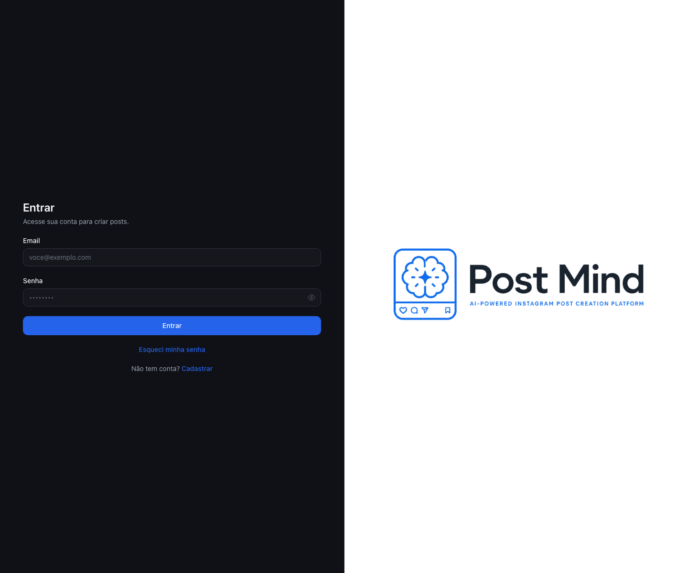
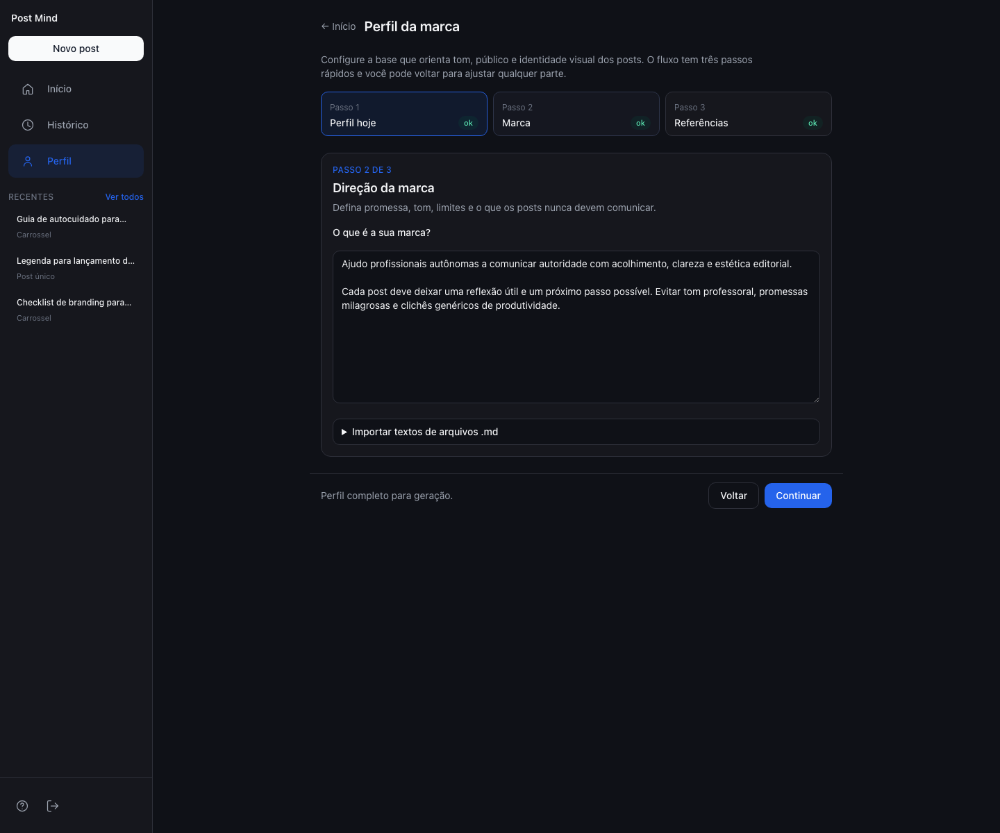
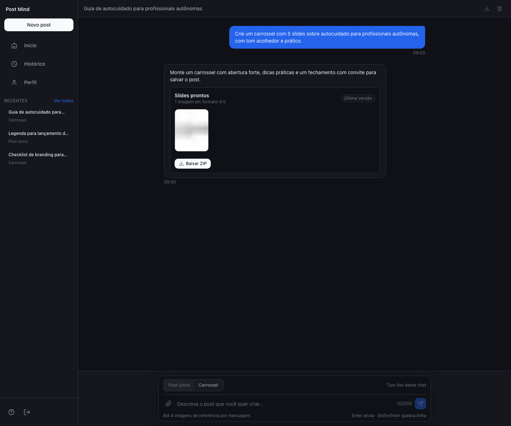
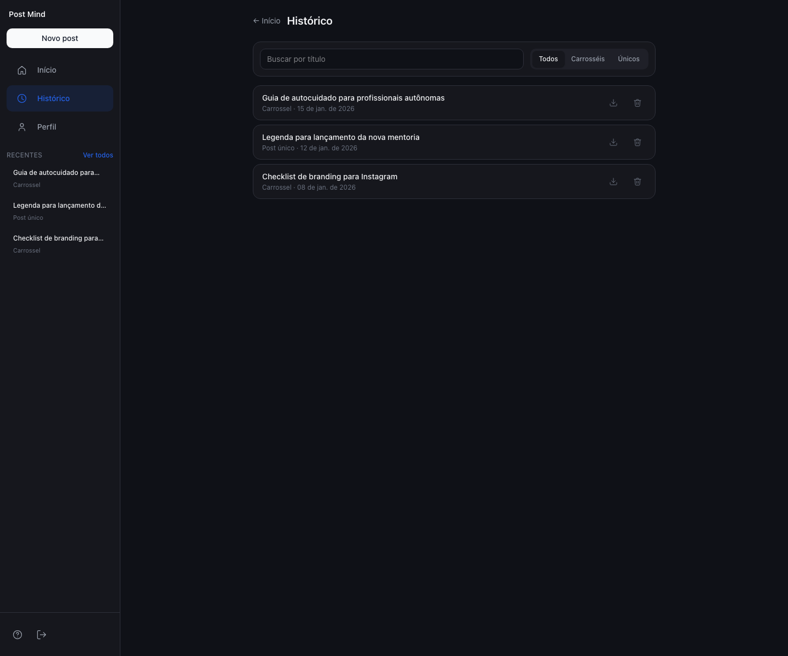

# Post Mind

Plataforma web para criação de posts Instagram (single e carrossel) com apoio de LLMs, alinhada à identidade visual e à marca do usuário.

## Arquitetura

| Serviço | Pasta | Papel |
|--------|--------|--------|
| **API** | `apps/api` | REST (Go, Echo): auth JWT, perfil, chats, jobs, S3 presign, callback do worker |
| **Worker** | `apps/worker` | Pipeline (Python, FastAPI, LangGraph, Playwright): gera HTML dos slides, exporta JPEG, upload S3 |
| **Web** | `apps/web` | SPA (React, Vite, TypeScript) |

A API delega geração ao worker; o worker chama `POST /internal/jobs/:id/complete` na API. Dados em **PostgreSQL**; slides e referências em **AWS S3**. Detalhe em [docs/ARCHITECTURE.md](docs/ARCHITECTURE.md) e [docs/TDD.md](docs/TDD.md).

## Screenshots

| Login | Perfil da marca |
| --- | --- |
|  |  |

| Chat com slides | Histórico |
| --- | --- |
|  |  |

Assets regeneráveis com `cd apps/web && npm run screenshots:readme`.

## Desenvolvimento local

1. **Variáveis de ambiente**  
   Copie e preencha os exemplos: `apps/api/.env.example` → `apps/api/.env`, `apps/worker/.env.example` → `apps/worker/.env` (incluindo `OPENAI_API_KEY`, credenciais S3 e `WORKER_API_KEY` alinhada entre API e worker).
   Os valores de exemplo são deliberadamente placeholders de desenvolvimento: troque `JWT_*`, `WORKER_API_KEY` e qualquer senha local antes de subir o ambiente.

2. **Stack com Docker** (Postgres, API, worker):

   ```bash
   docker compose up -d --build
   ```

   - API: `http://localhost:8080` (`GET /health`)
   - Worker: acessível só dentro da rede Docker (`worker:8000`). O `docker-compose.yml` de desenvolvimento **não** publica a 8000 no host; a API usa `WORKER_URL=http://worker:8000`. Para testar o health do worker a partir do host, mapeie `8000:8000` no serviço `worker` ou suba o worker fora do Compose e aponte a API para `http://host.docker.internal:8000` (conforme o SO).

3. **Frontend** (roda fora do Compose por padrão):

   ```bash
   cd apps/web && npm install && npm run dev
   ```

   O Vite costuma servir em `http://localhost:5173`. Ajuste `CORS_ALLOWED_ORIGINS` na API para essa origem (veja comentário em `apps/api/.env.example`).

4. **Migrações** (base Postgres vazia): `cd apps/api && make migrate-up` (exige `DATABASE_URL` no `apps/api/.env`).

## Comandos na raiz

| Comando | Descrição |
|--------|------------|
| `make e2e` | Sobe o Compose, roda testes E2E em `tests/e2e`, encerra o Compose |
| `make prod-up` / `make prod-down` | Stack de produção com `docker-compose.prod.yml` (ver [docs/RUNBOOK.md](docs/RUNBOOK.md)) |

## Documentação

- [docs/PRD.md](docs/PRD.md) — produto e regras de negócio  
- [docs/TDD.md](docs/TDD.md) — visão técnica agregada  
- [docs/RUNBOOK.md](docs/RUNBOOK.md) — deploy, variáveis, health  
- [docs/TESTING.md](docs/TESTING.md) — testes  

## Outros no repositório

- `.cursor/rules/` e `.cursor/skills/` — regras e skills para o fluxo de conteúdo e desenvolvimento no Cursor; prompts de sistema do worker em `apps/worker/prompts/`
