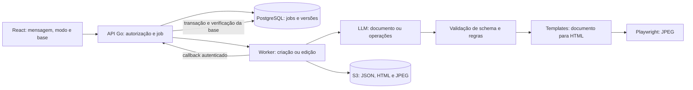

# TDD — Geração híbrida e versionamento de posts

| Campo | Valor |
| --- | --- |
| Responsável técnico | Desenvolvedor responsável pelo projeto |
| Equipe | Responsável pelo projeto |
| Ticket | Não há |
| Status | Proposta para revisão |
| Data | 2026-11-18 |
| Prazo | Não definido |

## Contexto e problema

O Post Mind gera posts para Instagram a partir de um chat. Atualmente a LLM devolve um pacote JSON contendo HTML completo por slide. O worker valida e renderiza esse HTML em JPEG; o S3 armazena os artefatos e o PostgreSQL guarda as mensagens, o job e as referências das imagens. Na edição, o worker recupera HTML de uma resposta anterior e solicita sua reescrita à LLM.

Esse fluxo permite variedade visual, mas a preservação de partes não solicitadas depende do modelo e de validações parciais. A comparação atual de texto em edições visuais usa o nome do arquivo para associar slides. O histórico de versões é implícito nas mensagens, sem uma base de edição identificada explicitamente. Não há dados medidos neste documento sobre frequência ou custo desses problemas.

**Objetivo:** tornar explícitos o conteúdo, a estrutura visual e a linhagem de cada versão, permitindo validar alterações antes da renderização e preservar os posts existentes.

## Escopo

### Incluído

- Criação de posts single e carrossel com documento estruturado versionado, templates flexíveis e renderização HTML/CSS controlada pelo sistema.
- Edição linear da versão estruturada mais recente, usando operações limitadas e rejeição de conflitos concorrentes.
- Persistência de snapshots imutáveis, associação explícita ao job, mensagens e slides, e leitura do histórico.
- Coexistência com posts legados gerados a partir de HTML, sem conversão automática.
- Segurança, validação, testes, observabilidade, ativação gradual e rollback.

### Fora do escopo inicial

- Editor visual de arrastar e soltar; publicação no Instagram; analytics de posts.
- Edição de versões históricas, ramificações, merge e restauração como ação de produto.
- Conversão automática de HTML legado em documento estruturado.
- CSS/HTML arbitrário fornecido pela LLM no fluxo estruturado.

## Decisões e invariantes

1. **Fonte canônica:** cada versão estruturada possui um snapshot JSON completo e imutável. HTML e JPEG são derivados; o pacote atual que contém HTML não é esse novo contrato.
2. **Templates flexíveis:** catálogo controlado de layouts e estilos, com parâmetros validados. O catálogo inicial e seus limites são definidos e testados na implementação; não se promete equivalência visual com qualquer HTML legado.
3. **Edição linear:** a base é a versão estruturada corrente no momento da aceitação e continua sujeita a validação na conclusão. Versões antigas são consultáveis, mas não selecionáveis como base na V1.
4. **Preservação:** uma edição altera somente os campos permitidos pelas operações aceitas; campos não atingidos permanecem semanticamente iguais no documento. Isso não garante pixels iguais após re-renderização, pois layout, fontes e imagens podem afetar o resultado.
5. **Versões publicadas são imutáveis:** um job bem-sucedido acrescenta uma versão. Falhas e conflitos não criam versão concluída nem substituem a corrente.
6. **Compatibilidade:** gerações legadas permanecem no fluxo HTML. Um chat designado como legado continua usando o fluxo legado; não é criada versão estruturada fictícia nem há fallback silencioso de um documento estruturado para HTML legado.
7. **Novos posts no mesmo chat:** uma intenção explícita de criação em chat estruturado gera uma nova versão raiz (`parent_version_id = null`) e substitui a referência corrente apenas após conclusão bem-sucedida. Resultados anteriores continuam no histórico. A identificação deve ser explícita na interface/contrato estruturado, sem depender somente das regex atuais. A criação também captura o ponteiro corrente no aceite e o compara na conclusão; se outro job o alterar, ela falha por conflito em vez de substituir silenciosamente o resultado mais recente.

## Arquitetura proposta



O grafo LangGraph mantém etapas de segurança, perfil, anexos, progresso e finalização. Um novo caminho estruturado substitui a geração livre de HTML por geração de documento ou de operações, validação e renderização. O caminho legado existente continua isolado por formato.

### Contrato lógico do documento

O exemplo ilustra o formato; enumerações, limites e regras serão definidos no schema V1 e mantidos como contrato versionado, com validação na entrada e antes do uso:

```json
{
  "schemaVersion": 1,
  "postType": "carousel",
  "slides": [{
    "id": "slide-1",
    "layout": "hero",
    "background": { "type": "solid", "color": "#172554" },
    "elements": [
      { "id": "title", "type": "text", "role": "heading", "content": "Como organizar sua rotina", "style": { "color": "#FFFFFF", "size": "large" } },
      { "id": "cover-image", "type": "image", "assetId": "attachment-uuid", "fit": "cover" }
    ]
  }]
}
```

IDs de slides e elementos são únicos e estáveis entre versões quando o elemento é preservado. O contrato deve limitar tamanho de texto, contagem de elementos, layouts, cores, estilos, fontes e formatos; single deve ter exatamente um slide e carrossel deve respeitar o limite definido pelo produto. Não aceitar scripts, CSS livre, URLs arbitrárias ou propriedades desconhecidas. `assetId` é uma referência autorizada pela API a anexo ou recurso da marca; não é uma URL ou chave S3 arbitrária fornecida pela LLM.

O schema descreve intenção visual, não um controle pixel a pixel. O renderizador deve ter versão própria registrada com a versão do schema e fontes/recursos controlados. O HTML e JPEG salvos são o registro visual entregue, mesmo quando versões futuras do renderizador alterarem o resultado.

### Fluxo de criação

1. A interface informa intenção de criação e o tipo do post; autenticação, ownership, setup, limites e validação de anexos atuais permanecem.
2. A API grava mensagem e job com o formato imutável já registrado no chat e o ponteiro esperado, e envia ao worker perfil, referências autorizadas, anexos e modo estruturado. O tipo do post permanece o `post_type` do chat; não é alterado por uma nova mensagem. O cliente recebe `202` e continua consultando o status existente.
3. A LLM produz documento estruturado. O worker valida schema, IDs, contagem, assets e regras de marca; falhas recuperáveis geram feedback limitado e retentativa com orçamento finito.
4. O renderizador gera HTML a partir do documento validado. As verificações de HTML/CSS, uso de anexos, legibilidade e renderização seguem aplicáveis. A LLM não recebe permissão para contornar o renderizador com código livre.
5. O worker envia snapshot, HTML e JPEG ao S3 e informa progresso. O callback inclui referências aos artefatos, formato, versões de schema/renderizador e intenção de criação.
6. A API valida contrato, prefixo e existência dos objetos. Em transação, persiste resposta, imagens, nova versão e ponteiro corrente, e marca o job `done`. A falha de qualquer etapa impede a publicação da versão.

### Fluxo de edição

1. A interface apresenta a versão corrente e envia sua identificação com o pedido. A API confere ownership, formato e se a base continua corrente; rejeita com conflito caso esteja desatualizada.
2. O worker recupera o snapshot exato, confere formato/schema e assets autorizados, e pede à LLM uma lista de operações tipadas.
3. O worker valida operações e alvos, aplica-as atomicamente a uma cópia e valida o documento resultante. A implementação aplica somente tipos e campos autorizados, mas a intenção em linguagem natural é interpretada pela LLM: sem confirmação humana não há garantia de que as operações propostas correspondam ao que o usuário pretendia. Não se aceita uma versão completa que ignore o escopo permitido.
4. O resultado é renderizado e validado; snapshot e artefatos são enviados a um prefixo novo do job.
5. No callback, a API bloqueia as linhas do chat e do job em ordem consistente e compara o ponteiro corrente com a base registrada no job. Isso também serializa criações concorrentes quando o ponteiro é nulo. Se coincidir, grava nova versão com `parent_version_id` igual à base e atualiza o ponteiro na mesma transação. Se não, marca o job como falho por conflito e solicita nova tentativa com a versão atual. Verificação apenas no dispatch não é suficiente para concorrência.

Exemplo lógico de operações:

```json
{
  "baseVersionId": "uuid-da-versao",
  "operations": [
    { "op": "set_background", "slideId": "slide-1", "background": { "type": "solid", "color": "#1D4ED8" } }
  ]
}
```

O catálogo inicial proposto inclui alterações de texto, fundo, estilo, imagem e layout, respeitando o catálogo de templates aprovado na implementação. A especificação final de cada operação deve definir campos alteráveis, pré-condições, limites e política de erros. Edições da V1 mantêm número e identidade dos slides; inclusão, remoção ou reordenação ficam fora até terem operações e critérios próprios. Um pedido ambíguo ou não representável encerra o job como `failed`, com código estável e mensagem em pt-BR solicitando reformulação, sem aplicar parcialmente as operações nem regenerar livremente o documento. Uma conversa interativa de esclarecimento fica fora desta V1.

## Modelo de dados e armazenamento

### PostgreSQL

Proposta de tabela `post_versions`:

| Campo | Regra |
| --- | --- |
| `id` | UUID, chave primária |
| `chat_id` | FK para chat, obrigatório |
| `job_id` | FK para job, obrigatório e único |
| `assistant_content_id` | FK para mensagem do assistente, obrigatório e único |
| `parent_version_id` | FK para versão anterior do mesmo chat; nulo em criação de nova raiz |
| `document_s3_key` | Chave do snapshot estruturado, obrigatória |
| `schema_version`, `renderer_version` | Identificadores obrigatórios |
| `created_at` | Data de conclusão |

Adicionar ao chat um campo de formato persistido (`legacy_html` ou `structured_v1`) e um ponteiro nullable para a versão estruturada corrente; adicionar ao job formato, modo e ponteiro esperado nullable, inclusive para `create`. Chats existentes recebem `legacy_html` na migração; novos chats recebem o formato escolhido na criação. Um job estruturado registra sempre o ponteiro observado, mesmo que nulo, e o compara no callback. Não usar `null` isoladamente para inferir formato. As FKs, restrições de unicidade e verificações transacionais devem assegurar que chat, job, mensagem e versão base pertençam ao mesmo contexto. A ordem de migração deve tratar o ciclo entre chat e versão; a exclusão do chat deve preservar cascatas válidas.

`chat_content_image` continua apontando para os JPEGs/HTMLs da mensagem correspondente. A relação entre versão e slides ocorre por `assistant_content_id`; leitura do histórico deve devolver o `versionId` associado à resposta. Não inferir a versão corrente apenas pela data das mensagens.

### S3

Manter o prefixo atual `slides/{jobId}/`, compatível com as validações existentes:

```text
slides/{jobId}/
  document.json
  slide_01.html
  slide_01.jpeg
  ...
```

A chave do documento é validada como pertencente ao job, com limite de tamanho e tipo esperado. Uploads são concluídos antes do callback; o PostgreSQL e o S3 não compartilham transação. O callback deve ser idempotente por job: repetição de sucesso já concluído retorna resultado equivalente, sem duplicar versão.

**Assets duráveis:** cada snapshot deve resolver imagens necessárias sem depender da permanência da referência no perfil. Ao criar uma versão, copiar os assets utilizados para um prefixo imutável daquela versão/job e registrar no documento IDs ligados a um manifesto autorizado com suas chaves; nas edições, copiar ou referenciar assets de versões anteriores com rastreamento de dependências. Para a V1 propõe-se copiar todos os assets usados por cada nova versão, inclusive os herdados, simplificando exclusão e retenção. A remoção de referência do perfil ou anexo original não invalida versões já concluídas. Não armazenar URLs assinadas no snapshot.

**Limpeza segura:** timeout ou falha de transporte no callback não prova que o banco rejeitou a conclusão. Em resultado desconhecido, não apagar objetos: repetir o mesmo callback idempotente e reconciliar com o estado persistido. Limpeza imediata só pode ocorrer com falha terminal confirmada e garantias de que o job não publicará; limpeza posterior exige janela de segurança, job terminal ou inexistente, ausência de referências e exclusão de jobs ativos. Usar exclusão idempotente com retentativas e inventário durável de chaves, inclusive upload parcial, `document.json`, pacote de geração e assets copiados. A rotina deve coordenar-se com callbacks e uploads para evitar corrida de verificação e exclusão. Nunca remover artefatos da versão base nem os referenciados por versão concluída.

**Exclusão e evicção:** capturar as chaves ou registrar uma tarefa durável de limpeza antes de excluir registros em cascata; a tarefa não pode depender de FK ao chat já removido. O fluxo atual de evicção exclui o chat antes de consultar suas chaves, portanto requer correção explícita: simplesmente acrescentar `document_s3_key` à consulta atual não basta. A limpeza deve incluir documentos, HTML, JPEG, pacotes, assets e anexos, preservando referências compartilhadas; falhas são reprocessadas e monitoradas.

## Contratos de API e compatibilidade entre serviços

A proposta preserva `POST /chats/:id/messages`, `202 {jobId}` e o polling existente. Acrescentar campos em JSON e multipart, com comportamento por formato:

```json
{ "content": "Mude o fundo do slide 1 para azul", "mode": "edit", "baseVersionId": "uuid" }
```

- `mode`: `create` ou `edit` no fluxo estruturado; `baseVersionId` obrigatório em `edit`, proibido em `create`. A ausência de `mode` em chat estruturado retorna `400 MODE_REQUIRED` sem gravar mensagem ou job; não inferir intenção nem desviar para o fluxo legado.
- Em chat legado, payloads antigos sem esses campos mantêm o comportamento atual; solicitações explícitas de formato estruturado em chat legado são rejeitadas de forma clara. O servidor determina o formato pelo chat, nunca pela flag atual ou pelo cliente.
- O frontend antigo não deve receber novos chats estruturados: habilitar somente após implantação de cliente capaz de enviar os campos, com verificação de capacidade por sessão/contrato ou bloqueio explícito; acesso posterior de cliente antigo a chat estruturado recebe erro de atualização, sem mutação. O mecanismo concreto de versão do cliente é parte da implementação e requisito para ativação.
- Resposta síncrona `409` com código `VERSION_CONFLICT` quando a base já estiver desatualizada no aceite; falha de concorrência descoberta no callback aparece como job `failed` com o mesmo código lógico. A interface recarrega o chat e oferece reenviar após confirmação do usuário.
- `GET /chats/:id` deve incluir, de forma aditiva, identificadores e formato por resposta e a versão estruturada corrente. O documento canônico não é exposto diretamente nesta V1; as operações são processadas no worker.
- No dispatch API → worker, enviar formato, modo, base esperada, chave do documento autorizado e metadados necessários; o worker não escolhe uma base por conta própria.
- No callback worker → API, enviar versão de contrato, chave do snapshot, versões do schema/renderizador e referências dos slides. A API valida o vínculo com o job e usa a base persistida no job como autoridade, não apenas a declarada no callback.

**Implantação mista:** primeiro implantar migração aditiva e leitores tolerantes a campos ausentes; depois API capaz de lidar com ambos os contratos; depois worker compatível com ambos; por fim frontend e ativação do fluxo estruturado. A API não deve despachar o novo formato a um worker antigo: exigir verificação explícita de capacidade/versão do worker antes de habilitá-lo. Atualmente o dispatch é HTTP com `BackgroundTasks`, não há fila durável nem negociação de capacidade; health check isolado não comprova suporte. Em múltiplas réplicas, cada destino elegível deve ser compatível ou usar roteamento que assegure isso.

## Compatibilidade, migração e rollback

- Registros anteriores não são reescritos. Sem `post_versions` ou documento estruturado, são legados e continuam visíveis, baixáveis e editáveis pelo caminho existente, sujeito às limitações atuais de HTML ausente.
- Chats legados permanecem legados. A criação estruturada é habilitada para novos chats quando o fluxo estiver ativo. Não há migração implícita de formato ao editar.
- A migração do banco é aditiva, sem backfill de snapshots; índices e constraints devem ser compatíveis com dados existentes.
- Ativação controlada por configuração/feature flag proposta, com padrão desligado e capacidade de acompanhar métricas por formato. A seleção de formato precisa persistir no chat no momento da criação e ser copiada para o job; desligar a flag não altera o formato de chats existentes.
- **Rollback:** desativar novas criações estruturadas e preservar migração, dados e leitores compatíveis. Não fazer rollback destrutivo do schema enquanto houver versões estruturadas. Manter worker capaz de ler/editar versões estruturadas já criadas; se indisponível, exibir leitura/download e bloquear edição com mensagem clara, sem encaminhar ao fluxo legado. Jobs em andamento são drenados ou finalizados como falhos com limpeza segura. Reativar somente após verificar integridade e compatibilidade das versões.

## Segurança

Autenticação e ownership devem ser verificados para chat, versão, anexos e assets em toda leitura e escrita. A API determina chaves autorizadas; o worker valida prefixos e não confia em referências arbitrárias retornadas pela LLM. O renderizador escapa texto e aceita apenas elementos, estilos, fontes e recursos permitidos; o HTML produzido não pode conter scripts arbitrários e o navegador mantém acesso de rede restrito. O código atual usa JavaScript interno confiável para correção de contraste: no fluxo estruturado, se mantido, suas mudanças devem ser determinísticas, registradas no HTML derivado e não alterar silenciosamente o snapshot canônico. Aplicar limites de tamanho de documento, operações, slides, anexos e tempo de execução. Logs registram IDs, códigos e métricas, sem prompts completos, documentos de marca, URLs assinadas ou credenciais.

## Testes e critérios de aceitação

| Área | Critério verificável |
| --- | --- |
| Criação | Single e carrossel válidos geram snapshot, HTML e JPEG; `done` somente após persistência completa. |
| Preservação | Alterar fundo preserva todos os demais campos do snapshot; alterações não autorizadas e operações inválidas não são aplicadas. |
| Conteúdo e assets | IDs únicos, limites, referências de outro usuário, propriedades desconhecidas e URLs arbitrárias são rejeitados. |
| Layout | Cenários representativos cobrem texto longo, imagens, contraste, fontes indisponíveis, overflow e renderização em ambiente controlado. |
| Concorrência | Dois jobs sobre a mesma base, inclusive duas primeiras criações com ponteiro nulo e uma criação concorrente com edição, não publicam ambas: um conclui e o outro recebe conflito. |
| Integridade | Callback repetido não duplica dados; resposta perdida após commit não causa exclusão dos arquivos publicados; falhas de upload, banco, callback e limpeza não publicam versão incompleta nem apagam a base. |
| Compatibilidade | Chat legado segue visível, baixável e editável pelo fluxo anterior; ausência de HTML gera erro explícito; cliente antigo não altera chat estruturado. |
| Retenção | Remover referência do perfil não quebra versão concluída; exclusão e evicção incluem todos os objetos mesmo após cascata. |
| Rollback | Desligar novas criações preserva leitura/download e mantém edição estruturada com worker compatível; indisponibilidade bloqueia edição sem fallback silencioso. |
| Segurança | Usuário não acessa versões ou assets de outro; callback rejeita chaves fora do job e objetos ausentes. |

Executar testes unitários de schema, operações, renderização e routing; integração Go/Postgres para transações, conflitos e callbacks; testes do worker com LLM/S3 simulados; e E2E de criação, edição, conflito e histórico. Testes visuais devem usar navegador e fontes fixados e cobrir templates selecionados, sem depender apenas de snapshots para validar semântica.

## Observabilidade e riscos

Registrar por `job_id`, `chat_id`, formato, schema/renderizador e etapa: duração, falhas de validação, retentativas, conflitos, falhas de upload/callback, órfãos e sucesso por formato. Não registrar dados sensíveis do documento. Comparar custo, tempo e taxa de falha entre legado e estruturado após uma linha de base; metas numéricas ainda precisam ser acordadas. Alertar para aumento de jobs falhos/travados e falhas repetidas de reconciliação, conforme infraestrutura disponível.

| Risco | Mitigação |
| --- | --- |
| Variedade visual insuficiente | Validar catálogo com exemplos reais antes de ampliar tráfego; evoluir layouts de forma versionada. |
| LLM produz operações inválidas ou interpreta mal o pedido | Schema estrito, orçamento de retentativas, erro/esclarecimento explícito e testes de preservação. |
| Edições concorrentes sobrescrevem trabalho | Comparação da base na transação de conclusão e conflito para o perdedor. |
| Objeto S3 órfão ou versão sem arquivo | Verificar objetos antes do commit; limpeza idempotente e reconciliação posterior com janela de segurança. |
| Atualização de template altera re-renderização | Registrar versão do renderizador e manter JPEG/HTML entregues imutáveis; controlar fontes. |
| Jobs longos são marcados como travados | Monitorar duração por etapa e heartbeat; ajustar política ou implementação antes de ampliar carga. |
| Rollback quebra edição de versões novas | Manter leitores e worker compatíveis e usar migrações aditivas. |

## Plano de implementação

1. **Contrato e protótipo:** definir schema, operações, layouts e amostras representativas; validar renderização e preservação sem mudar o fluxo de produção.
2. **Persistência e integração:** migração aditiva, contratos versionados, validação de ownership/artefatos e conclusão transacional idempotente.
3. **Criação estruturada:** caminho paralelo no worker, templates, testes e habilitação controlada para novos chats.
4. **Edição linear:** operações, validação do escopo e controle de concorrência na aceitação e conclusão.
5. **Interface e compatibilidade:** modo/base explícitos, histórico e estados de erro, mantendo fluxo legado; a ativação do passo 3 só ocorre depois de API, worker e frontend compatíveis estarem implantados.
6. **Operação:** retenção de assets, exclusão/evicção segura, reconciliação de órfãos, métricas e ensaio de rollback devem estar prontos antes da ativação estruturada; depois comparar resultados e expandir gradualmente.

Cada fase deve ser revisada e testada antes da próxima; não há prazo estimado. O rollout de produção depende de validação com exemplos de marca reais e do responsável técnico.

## Questões em aberto

- Quais layouts, estilos, limites e fontes compõem o catálogo inicial? Definir a partir de exemplos reais antes de congelar o schema V1.
- Qual texto e código específico apresentar quando o pedido não couber no catálogo? A V1 encerra o job com erro e pedido de reformulação, preservando a versão atual.
- Quais metas de latência, custo, qualidade visual e taxa de erros justificam expansão do rollout? Definir após linha de base.
- Qual mecanismo de feature flag e reconciliação de objetos órfãos será operado no ambiente de produção? Definir antes da ativação.

## Alternativas consideradas

- **Manter HTML livre:** menor custo de mudança e maior liberdade, mas preservação e edição pontual seguem frágeis.
- **SVG gerado livremente:** formato gráfico adequado, mas a reescrita pela LLM ainda pode alterar elementos não solicitados.
- **Documento estruturado com templates:** controle e validação melhores, ao custo de limitar a variedade aos recursos do renderizador. É a abordagem proposta.
