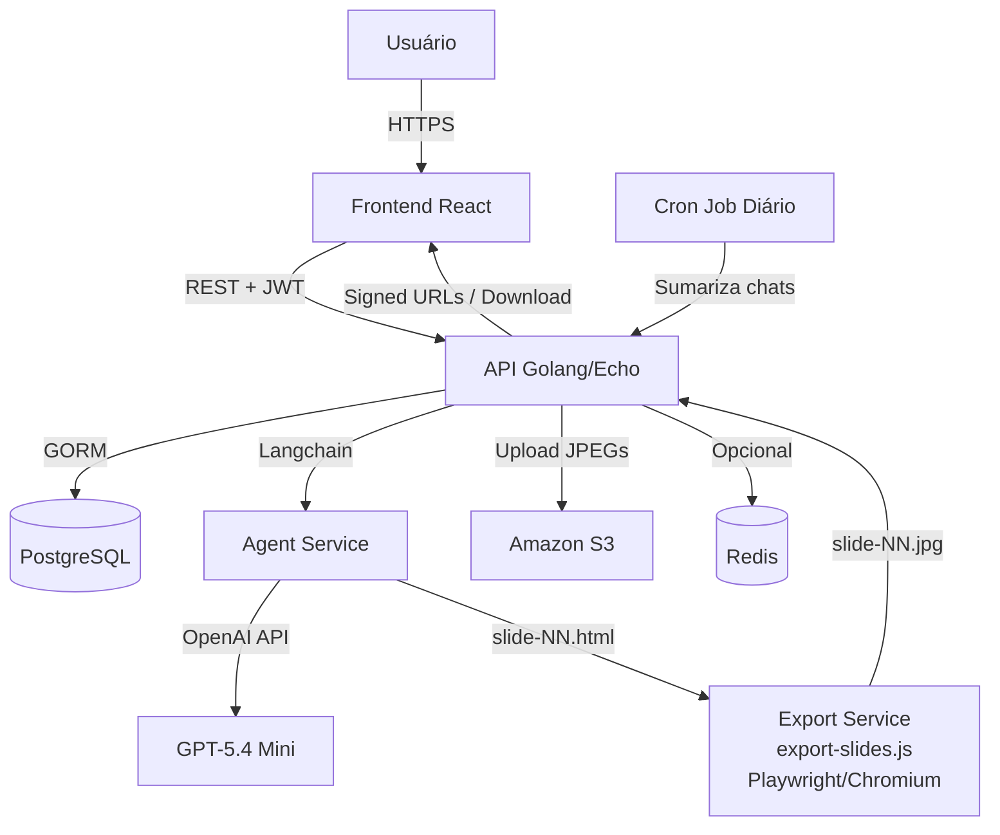

# TDD - Content Creator Agent

| Campo           | Valor                          |
| --------------- | ------------------------------ |
| Tech Lead       | Solo Dev                       |
| Time            | Solo                           |
| Epic/Ticket     | —                              |
| Figma/Design    | —                              |
| Status          | Draft                          |
| Criado em       | 2026-04-10                     |
| Última Revisão  | 2026-04-10                     |

---

## Contexto

O **Content Creator Agent** é uma plataforma web que automatiza a criação de posts para Instagram utilizando LLMs, respeitando a identidade visual e as diretrizes de comunicação já estabelecidas pelo usuário. O sistema atua como um agente inteligente que combina regras de design, skills de criação de conteúdo e engenharia de prompts para produzir posts de alta qualidade de forma consistente.

**Background:**
Atualmente, a criação de posts no Instagram que respeitam uma identidade visual consolidada exige conhecimento profundo das boas práticas da plataforma, das regras de design e do tom de voz da marca. Esse processo é repetitivo, demorado e sujeito a inconsistências quando feito manualmente ou com ferramentas genéricas.

**Domínio:**
O sistema pertence ao domínio de criação de conteúdo digital para redes sociais, com foco exclusivo no Instagram. O ciclo de vida central gira em torno de `chats` (sessões de criação), onde o usuário escreve um prompt, recebe o conteúdo gerado (imagens/slides), e pode revisá-lo ou baixá-lo.

**Stakeholders:**
Criadores de conteúdo, social media managers e empreendedores digitais que precisam manter consistência visual e qualidade na sua presença no Instagram.

---

## Definição do Problema & Motivação

### Problemas que Estamos Resolvendo

- **Problema 1 — Inconsistência na identidade visual**: Ferramentas genéricas de IA não conhecem a paleta de cores, tipografia ou estilo da marca do usuário.
  - Impacto: Posts fora do padrão visual comprometem a credibilidade da marca.

- **Problema 2 — Curva de aprendizado em prompts**: Usuários sem expertise em prompt engineering obtêm resultados abaixo do potencial dos modelos.
  - Impacto: Baixa qualidade de output, necessidade de múltiplas tentativas, desperdício de tokens.

- **Problema 3 — Ausência de histórico acessível**: Não existe um lugar centralizado para revisar, editar e baixar posts criados anteriormente.
  - Impacto: Dificuldade de reutilização e iteração sobre conteúdos anteriores.

### Por que Agora?

- Crescimento acelerado do uso de IA para criação de conteúdo cria demanda por soluções especializadas.
- A maturidade das skills existentes (`create-social-post`, `map-instagram-profile`, `prompt-engineering-meta`) já fornece a base necessária para a implementação.
- Ausência de ferramentas focadas em identidade visual + IA no mercado nacional.

### Impacto de Não Resolver

- **Negócio**: Perda de vantagem competitiva em um mercado em crescimento.
- **Técnico**: Skills e regras do projeto ficam subutilizadas sem uma interface que as exponha.
- **Usuário**: Processo manual, inconsistente e demorado permanece como único caminho.

---

## Escopo

### ✅ Em Escopo (V1 — MVP)

- Cadastro de usuário com geração de chave única de recuperação
- Login e autenticação via JWT (access token + refresh token)
- Tela principal com input rich text para criação de posts
- Suporte a posts do tipo **single** e **carrossel**
- Processamento de prompts via `Prompt Engineering Meta` + skill `create-social-post`
- Geração de imagens com LLM (GPT-5.4 Mini via Langchain)
- Upload e armazenamento de imagens geradas no Amazon S3
- Visualização e download de posts (arquivo único ou `.zip`)
- Tela de histórico com os 5 últimos posts criados
- Ações no histórico: re-prompt (refinamento), download e exclusão
- Cron job diário para resumo compacto de chats com conteúdo novo
- Setup inicial obrigatório via skill `map-instagram-profile`
- Segurança: rate limiting, sanitização, prevenção de prompt injection, RSA em trânsito
- Autenticação obrigatória para todas as rotas; isolamento total de dados por usuário

### ❌ Fora de Escopo (V1)

- Tela de configuração de perfil e upload de arquivos de referência (V2)
- Publicação direta no Instagram via API
- Suporte a outras redes sociais
- Análise de performance dos posts
- Plano de assinatura / cobrança
- Multi-tenancy / workspaces compartilhados
- Suporte a múltiplos idiomas na interface (somente PT-BR no V1)
- Redis como dependência obrigatória (opcional no V1)

### 🔮 Considerações Futuras (V2+)

- Tela de perfil para configuração da identidade visual pelo próprio usuário
- Integração com Instagram API para publicação direta
- Expansão para outros formatos (Reels, Stories)
- Histórico expandido (mais de 5 posts)

---

## Solução Técnica

### Visão Geral da Arquitetura

O sistema é composto por uma SPA React, uma API REST em Golang (Echo), um agente LLM (Langchain + OpenAI), Amazon S3 para artefatos gerados e PostgreSQL como banco principal.

**Componentes Principais:**

| Componente           | Responsabilidade                                                                 |
| -------------------- | -------------------------------------------------------------------------------- |
| **Frontend (React)** | Interface do usuário — autenticação, prompt input, histórico, download           |
| **API (Golang/Echo)**| Roteamento, autenticação JWT, validação, orquestração entre serviços             |
| **Agent Service**    | Processamento de prompts via Langchain + aplicação das skills e rules            |
| **Export Service**   | Renderiza slides HTML/CSS → JPEG via `export-slides.js` (Playwright/Chromium)   |
| **S3**               | Armazenamento dos JPEGs gerados e arquivos HTML dos slides                       |
| **PostgreSQL**       | Persistência de usuários, chats, mensagens e resumos                             |
| **Redis** (opcional) | Rate limiting e cache de sessões                                                 |
| **Cron Job**         | Sumarização diária de chats com conteúdo novo                                    |

**Diagrama de Arquitetura:**



### Fluxo de Dados — Criação de Post

1. Usuário escreve prompt na interface (rich text + imagens de referência opcionais)
2. Frontend envia `POST /chats/:id/messages` com conteúdo e anexos
3. API valida JWT, aplica rate limiting, sanitiza inputs
4. Agent Service recebe o prompt e o processa através do `Prompt Engineering Meta`
5. Prompt otimizado é enviado para a skill `create-social-post` com contexto do perfil do usuário
6. LLM (GPT-5.4 Mini) gera o conteúdo dos slides em **HTML/CSS** (um arquivo `slide-NN.html` por slide para carrossel, ou único para post single)
7. Backend executa `scripts/export-slides.js` via Playwright (Chromium headless) no modo `--export --confirm`, capturando cada slide como **JPEG** (768×1376px, qualidade 92)
8. JPEGs gerados são enviados ao S3; referências salvas no banco
9. Resposta retornada ao frontend com links de visualização e download
8. Resposta é retornada ao frontend com links de visualização e download

### Fluxo de Dados — Cron Job de Sumarização

1. Job roda diariamente em horário de baixo tráfego
2. Busca todos os chats que possuem `chat_content` mais recente do que o `chat_content_resume.summarized_at`
3. Para cada chat elegível, envia o histórico completo para o GPT-5.4 Mini com instrução de sumarização compacta
4. Salva/atualiza o registro em `chat_content_resume`

### Fluxo de Dados — Setup Inicial Obrigatório

- Ao acessar a tela de criação, o sistema verifica se a estrutura da skill `map-instagram-profile` está presente para o usuário
- Se ausente: bloqueia o fluxo e exibe mensagem clara com o passo a passo do que deve ser feito
- Se presente: libera o acesso completo à interface de criação

### APIs & Endpoints

#### Autenticação

| Endpoint                     | Método | Descrição                          | Body                               | Resposta                     |
| ---------------------------- | ------ | ---------------------------------- | ---------------------------------- | ---------------------------- |
| `/auth/register`             | POST   | Cadastra novo usuário              | `{ email, password }`              | `{ securityKey }` (uma vez)  |
| `/auth/login`                | POST   | Autentica e retorna tokens         | `{ email, password }`              | `{ accessToken, refreshToken }` |
| `/auth/refresh`              | POST   | Renova access token                | `{ refreshToken }`                 | `{ accessToken }`            |
| `/auth/recover-password`     | POST   | Redefine senha com chave de segurança | `{ email, securityKey, newPassword }` | `{ success: true }` |

#### Chats

| Endpoint             | Método | Descrição                              | Resposta              |
| -------------------- | ------ | -------------------------------------- | --------------------- |
| `/chats`             | GET    | Lista os últimos 5 chats do usuário    | `Chat[]`              |
| `/chats`             | POST   | Cria novo chat                         | `Chat`                |
| `/chats/:id`         | GET    | Retorna chat com mensagens             | `Chat + Message[]`    |
| `/chats/:id`         | DELETE | Remove chat e arquivos associados      | `204 No Content`      |
| `/chats/:id/messages`| POST   | Envia prompt e recebe resposta do agent| `Message`             |

#### Arquivos

| Endpoint                         | Método | Descrição                              | Resposta         |
| -------------------------------- | ------ | -------------------------------------- | ---------------- |
| `/chats/:id/files`               | GET    | Lista arquivos gerados no chat         | `File[]`         |
| `/chats/:id/files/download`      | GET    | Download de todos os arquivos (.zip)   | `application/zip`|
| `/chats/:id/files/:fileId`       | GET    | Download de arquivo único              | `image/jpeg`     |

**Exemplo de Contrato — Criar Mensagem:**

```json
// POST /chats/:id/messages
{
  "content": "Crie um carrossel sobre produtividade para minha audiência de empreendedores",
  "attachments": [
    { "type": "image", "s3Key": "uploads/ref-image-1.jpg" }
  ]
}

// Response 200 OK
{
  "id": "msg-uuid",
  "chatId": "chat-uuid",
  "role": "assistant",
  "content": "Post carrossel criado com 5 slides...",
  "files": [
    { "id": "file-uuid", "name": "slide-01.jpg", "downloadUrl": "..." },
    { "id": "file-uuid", "name": "slide-02.jpg", "downloadUrl": "..." }
  ],
  "createdAt": "2026-04-10T15:00:00Z"
}
```

### Modelo de Dados

**Tabelas:**

```
users
  - id            UUID PK
  - email         VARCHAR(255) UNIQUE NOT NULL
  - password_hash VARCHAR NOT NULL
  - security_key_hash VARCHAR NOT NULL   -- hash da chave de recuperação
  - created_at    TIMESTAMPTZ
  - updated_at    TIMESTAMPTZ

chats
  - id            UUID PK
  - user_id       UUID FK → users.id
  - title         VARCHAR(255)
  - post_type     ENUM('single', 'carousel')
  - created_at    TIMESTAMPTZ
  - updated_at    TIMESTAMPTZ
  INDEXES: user_id, created_at (DESC)

chat_content
  - id            UUID PK
  - chat_id       UUID FK → chats.id
  - role          ENUM('user', 'assistant')
  - content       TEXT
  - created_at    TIMESTAMPTZ
  INDEXES: chat_id, created_at

chat_content_image
  - id            UUID PK
  - chat_content_id UUID FK → chat_content.id
  - s3_key        VARCHAR NOT NULL
  - file_name     VARCHAR(255)
  - mime_type     VARCHAR(100)
  - created_at    TIMESTAMPTZ
  INDEXES: chat_content_id

chat_content_resume
  - id              UUID PK
  - chat_id         UUID FK → chats.id UNIQUE
  - summary         TEXT
  - last_content_at TIMESTAMPTZ   -- data do conteúdo mais recente considerado
  - summarized_at   TIMESTAMPTZ
  INDEXES: chat_id, summarized_at
```

**Estratégia de Migração:**
- Migrations geradas via GORM Auto-Migrate ou arquivos SQL versionados
- Testadas em ambiente de staging antes da produção
- Down migrations obrigatórias para rollback

**Limite de Posts por Usuário:**
- Máximo de 5 chats ativos por usuário
- Ao criar o 6º chat: o sistema remove automaticamente o mais antigo (incluindo seus arquivos no S3)
- O usuário também pode deletar qualquer chat manualmente a qualquer momento via tela de histórico

---

## Riscos

| Risco | Impacto | Probabilidade | Mitigação |
|-------|---------|---------------|-----------|
| Downtime da OpenAI API | Alto | Médio | Circuit breaker; retornar mensagem de erro amigável; retry com backoff exponencial |
| Custo elevado de tokens (GPT-5.4 Mini) | Médio | Médio | Cron job de sumarização compacta; limite de **4.000 tokens de saída** por requisição (revisão futura com dados reais); enviar resumo ao invés do histórico completo quando disponível |
| Vazamento da chave de segurança do usuário | Alto | Baixo | Exibida apenas uma vez no cadastro; armazenada somente como hash bcrypt; documentar claramente ao usuário |
| Falha no upload para S3 | Médio | Baixo | Retry automático com backoff; transação não conclui sem S3 salvo com sucesso |
| Falha no export via Playwright (Chromium crash, timeout) | Médio | Baixo | Capturar erro do processo filho; retornar mensagem amigável ao usuário; o HTML gerado é preservado para re-tentativa |
| Playwright/Chromium indisponível no ambiente de deploy | Alto | Baixo | Garantir instalação do Chromium no Dockerfile do backend (`npx playwright install chromium`); validar no CI |
| Prompt injection por usuário malicioso | Alto | Médio | Sanitização de inputs; instrução de sistema no agente proibindo execução de comandos; validação de output antes de retornar |
| Crescimento descontrolado de storage S3 | Médio | Médio | Deletar arquivos S3 ao deletar chat; política de lifecycle no bucket para arquivos órfãos |
| Rate limiting insuficiente causando abuso da API de IA | Alto | Médio | Rate limiting por usuário na camada da API; separar limite para endpoints que acionam o LLM |

---

## Plano de Implementação

| Fase | Tarefa | Descrição | Status | Estimativa |
|------|--------|-----------|--------|------------|
| **Fase 1 — Base** | Setup do projeto | Estrutura inicial Golang (Echo), módulos, Dockerfile | TODO | 1d |
| | Banco de dados | Schema, migrations, conexão GORM | TODO | 1d |
| | Autenticação | Register, Login, JWT, recover password | TODO | 2d |
| **Fase 2 — Core API** | CRUD de Chats | Endpoints de chat (create, list, get, delete) | TODO | 2d |
| | Integração S3 | Upload, download, delete de arquivos | TODO | 1d |
| | Limite de 5 posts | Lógica de remoção automática/manual | TODO | 0.5d |
| **Fase 3 — Agent** | Langchain setup | Configuração do agente com skills e rules | TODO | 2d |
| | Endpoint de mensagem | POST /chats/:id/messages com processamento completo | TODO | 2d |
| | Verificação de perfil | Validação do setup map-instagram-profile | TODO | 1d |
| **Fase 4 — Frontend** | Setup React | Estrutura base, roteamento, Zustand, React Query | TODO | 1d |
| | Tela de Auth | Login, Cadastro, exibição da security key | TODO | 2d |
| | Tela Principal | Input rich text, attachments, resposta do agent | TODO | 3d |
| | Tela de Histórico | Lista de chats, download, re-prompt, delete | TODO | 2d |
| **Fase 5 — Cron Job** | Sumarizador | Job diário com comparação de datas e GPT-5.4 Mini | TODO | 1.5d |
| **Fase 6 — QA & Deploy** | Testes | Unit + integration + E2E dos fluxos críticos | TODO | 3d |
| | Deploy staging | Deploy completo, smoke tests | TODO | 1d |
| | Deploy produção | Rollout com monitoramento ativo | TODO | 1d |

**Estimativa Total:** ~27 dias (~5.5 semanas)

**Dependências entre fases:**
- Fase 1 → Fase 2 → Fase 3 (backend sequencial)
- Fase 2 pode ser desenvolvida em paralelo com início da Fase 4
- Fase 5 pode ser desenvolvida em paralelo com Fase 4
- Fase 6 depende de todas as anteriores

---

## Considerações de Segurança

### Autenticação & Autorização

- **Mecanismo**: JWT com access token de vida curta (15 min) mantido em memória no cliente + refresh token (7 dias) armazenado em cookie `httpOnly + Secure + SameSite=Strict`
- **Fluxo de renovação**: Frontend detecta access token expirado e chama `POST /auth/refresh` automaticamente; o cookie httpOnly é enviado pelo browser sem exposição ao JavaScript
- **Proteção XSS**: Access token nunca persiste em `localStorage` ou `sessionStorage`
- **Proteção CSRF**: Cookie `SameSite=Strict` + validação de header `Origin` no backend impedem requisições cross-site
- **Autorização**: Todos os recursos são estritamente isolados por `user_id`; qualquer tentativa de acessar recurso de outro usuário retorna `403 Forbidden`
- **Rotas protegidas**: Todas as rotas exceto `/auth/*` exigem JWT válido no header `Authorization: Bearer <token>`

### Chave Única de Segurança

- Gerada no momento do cadastro (UUID v4 ou similar de alta entropia)
- **Exibida uma única vez** ao usuário com instrução clara de guardar em local seguro
- Armazenada no banco somente como hash bcrypt (nunca em texto plano)
- Usada exclusivamente para recuperação de senha (não como fator de autenticação no login normal)

### Proteção de Dados

**Criptografia:**
- **Em Trânsito**: TLS 1.3 em todas as comunicações; campos sensíveis (senha, security key) adicionalmente criptografados com RSA antes de serem enviados pelo frontend
- **Em Repouso**: Senhas armazenadas com bcrypt (custo ≥ 12); chaves de segurança com bcrypt
- **Secrets**: Chaves de API (OpenAI, AWS) armazenadas em variáveis de ambiente / secret manager; nunca expostas no frontend

**PII Tratado:**
- Email e dados de perfil do usuário
- Base legal: Execução de contrato (LGPD Art. 7, II)
- Retenção: Dados mantidos enquanto a conta estiver ativa; exclusão sob solicitação

### Boas Práticas Aplicadas

- ✅ Validação e sanitização de todos os inputs (Zod no frontend, validação no backend)
- ✅ Prevenção de SQL Injection via GORM (queries parametrizadas)
- ✅ Prevenção de Prompt Injection: sanitização antes de enviar ao LLM + instrução de sistema restritiva no agente
- ✅ Rate limiting implementado em memória no V1 (middleware no Echo); por usuário autenticado para endpoints de LLM com limite mais restritivo; por IP para endpoints públicos (`/auth/*`)
- ✅ Proteção CSRF via `SameSite=Strict` no cookie de refresh token + validação de header `Origin`
- ✅ Headers de segurança HTTP (CORS restritivo, X-Content-Type-Options, etc.)
- ✅ Logs de auditoria para operações sensíveis (login, criação de conta, recover password)

---

## Estratégia de Testes

| Tipo de Teste | Escopo | Cobertura Alvo | Abordagem |
|---------------|--------|----------------|-----------|
| **Unitários** | Services, helpers, validações | > 75% | Go testing nativo |
| **Integração** | Endpoints da API + banco | Fluxos críticos | Supertest / httptest (Go) + DB de teste |
| **E2E** | Fluxos completos de usuário | Happy path + casos de erro | Playwright |
| **Contrato** | Integração com OpenAI | Mock das respostas | Mocks fixos para CI |

### Cenários Críticos

**Autenticação:**
- ✅ Cadastro com email duplicado → `409 Conflict`
- ✅ Login com senha errada → `401 Unauthorized`
- ✅ Recover password com security key incorreta → `403 Forbidden`
- ✅ Acesso a rota protegida sem token → `401`
- ✅ Acesso ao chat de outro usuário → `403`

**Criação de Post:**
- ✅ Prompt válido → post gerado e salvo no S3
- ✅ Setup de perfil ausente → fluxo bloqueado com mensagem clara
- ✅ Falha na OpenAI API → mensagem de erro amigável, sem crash
- ✅ Atingir limite de 5 chats → remoção correta do mais antigo

**Histórico:**
- ✅ Download de arquivo único → arquivo correto retornado
- ✅ Download de todos os arquivos → `.zip` gerado corretamente
- ✅ Deletar chat → arquivos do S3 removidos junto

**Cron Job:**
- ✅ Chat sem conteúdo novo → resumo não atualizado
- ✅ Chat com conteúdo novo → resumo criado/atualizado

---

## Monitoramento e Observabilidade

### Métricas Principais

| Métrica | Tipo | Threshold de Alerta |
|---------|------|---------------------|
| `api.latency` (p95) | Latência | > 2s por 5min |
| `api.error_rate` | Taxa de erro | > 2% por 5min |
| `llm.request_duration` (p95) | Latência externa | > 10s por 5min |
| `llm.errors` | Contador | > 5 em 1min |
| `s3.upload_failures` | Contador | > 3 em 1min |
| `cron.summary_job_duration` | Duração | > 5min |
| `auth.failed_attempts` | Contador por IP | > 20 em 5min |

### Logs Estruturados

```json
{
  "level": "info",
  "timestamp": "2026-04-10T15:00:00Z",
  "message": "Chat message processed",
  "context": {
    "userId": "user-uuid",
    "chatId": "chat-uuid",
    "postType": "carousel",
    "llm_duration_ms": 3200,
    "files_generated": 5
  }
}
```

**O que logar:**
- ✅ Todas as requisições à API (método, path, status, duração)
- ✅ Chamadas ao LLM (duração, tokens utilizados, sucesso/erro)
- ✅ Uploads e downloads do S3
- ✅ Erros e exceções com stack trace
- ✅ Eventos de negócio (cadastro, criação de post, exclusão de chat)
- ✅ Tentativas de autenticação falhas

**O que NÃO logar:**
- ❌ Senhas ou hashes
- ❌ Security keys (nem em hash)
- ❌ Tokens JWT
- ❌ Conteúdo de prompts com PII do usuário (redactar quando necessário)

### Alertas

| Alerta | Severidade | Canal | Ação |
|--------|-----------|-------|------|
| Taxa de erro > 5% | P1 | Email/PagerDuty | Investigação imediata, rollback se necessário |
| OpenAI API inacessível | P1 | Email | Ativar modo de degradação, notificar usuários |
| Latência p95 > 5s | P2 | Slack/Email | Investigar gargalo de performance |
| Tentativas de auth suspeitas | P2 | Email | Revisar logs, bloquear IP se necessário |

---

## Plano de Rollback

### Estratégia de Deploy

- **Feature Flag**: Variável de ambiente `APP_ENABLED` para desligar a aplicação rapidamente
- **Deploy**: Container-based (Docker); rollback = trocar imagem pela versão anterior
- **Banco**: Migrations com down migration obrigatória; snapshot antes de cada migração em produção

### Gatilhos de Rollback

| Gatilho | Ação |
|---------|------|
| Taxa de erro > 5% por 5 min após deploy | Rollback imediato para versão anterior |
| Falhas de autenticação > 50% | Rollback + investigação de segurança |
| Falha em migração de banco | PARAR deploy; não prosseguir; executar down migration |
| Impossibilidade de conectar ao S3 | Desabilitar criação de posts; investigar configurações |
| Dados de usuários inacessíveis | Rollback imediato + incident response |

### Passos de Rollback

1. Identificar o problema nos logs/métricas
2. Trocar a imagem Docker para a versão anterior estável
3. Se houve migração de banco: executar down migration
4. Verificar que os endpoints críticos voltaram a responder corretamente
5. Comunicar o incidente no canal de engineering
6. Agendar post-mortem em até 24h

### Pós-Rollback

- **Análise de Causa Raiz**: Até 24h após o incidente
- **Fix**: Corrigir em ambiente de desenvolvimento com testes adicionais cobrindo o caso de falha
- **Re-deploy**: Seguir a mesma sequência de verificação

---

## Métricas de Sucesso

| Métrica | Baseline | Target | Medição |
|---------|----------|--------|---------|
| Latência da API (p95) | N/A | < 500ms | APM / Logs |
| Taxa de erro geral | N/A | < 0.5% | APM / Logs |
| Tempo de geração de post | N/A | < 15s (p95) | Métricas do Agent Service |
| Taxa de conclusão do fluxo | N/A | > 85% | Analytics de eventos |
| Usuários que completam setup inicial | N/A | > 90% | Analytics de eventos |
| Cobertura de testes | N/A | > 75% | CI (go test -cover) |

---

## Alternativas Consideradas

### Backend

| Opção | Prós | Contras | Decisão |
|-------|------|---------|---------|
| **Golang + Echo** ✅ | Alta performance, baixo consumo de memória, tipagem forte, ótimo para APIs | Ecossistema de AI menos maduro que Python | **Escolhido** — performance e familiaridade do time |
| Node.js + Fastify | Ecossistema AI muito rico, async nativo, grande comunidade | Maior consumo de memória, menor performance em I/O intensivo | Descartado — Golang atende melhor os requisitos |
| Python + FastAPI | Ecossistema AI mais maduro (LangChain nativo), muitas bibliotecas | Menor performance, tipagem dinâmica pode gerar bugs silenciosos | Considerado para o Agent Service; descartado em favor de manter stack único |

### Banco de Dados

| Opção | Prós | Contras | Decisão |
|-------|------|---------|---------|
| **PostgreSQL** ✅ | Robusto, ACID, full-text search, excelente suporte GORM | Requer mais configuração que SQLite | **Escolhido** — escalabilidade e confiabilidade |
| SQLite | Zero config, perfeito para desenvolvimento | Não escala para produção multi-usuário | Descartado |
| MongoDB | Flexível para schema dinâmico | Menos adequado para dados relacionais (users ↔ chats) | Descartado |

### Armazenamento de Arquivos

| Opção | Prós | Contras | Decisão |
|-------|------|---------|---------|
| **Amazon S3** ✅ | Escalabilidade ilimitada, CDN, lifecycle policies, custo por uso | Vendor lock-in AWS | **Escolhido** — padrão de mercado, custo-benefício excelente |
| Filesystem local | Zero custo, simples | Não escala, sem redundância, problemático em containers | Descartado |
| Cloudflare R2 | Sem egress fees, compatível com S3 API | Ecossistema menor, menos familiar | Alternativa viável para V2 |

---

## Roadmap / Timeline

| Fase | Entregas | Duração | Data Alvo | Status |
|------|----------|---------|-----------|--------|
| **Fase 1 — Base** | Setup, banco, autenticação completa | 4d | — | ⏳ Pendente |
| **Fase 2 — Core API** | CRUD chats, S3, limite de posts | 3.5d | — | ⏳ Pendente |
| **Fase 3 — Agent** | Langchain, endpoint de mensagem, validação de perfil | 5d | — | ⏳ Pendente |
| **Fase 4 — Frontend** | Auth, tela principal, histórico | 8d | — | ⏳ Pendente |
| **Fase 5 — Cron Job** | Sumarizador diário | 1.5d | — | ⏳ Pendente |
| **Fase 6 — QA & Deploy** | Testes, staging, produção | 5d | — | ⏳ Pendente |

**Duração Total Estimada:** ~27 dias (~5.5 semanas)

**Milestones:**
- 🎯 M1: API completa com autenticação e criação de posts (Fases 1–3)
- 🎯 M2: Frontend integrado e funcional (Fase 4)
- 🎯 M3: MVP em produção com monitoramento ativo (Fase 6)

**Caminho Crítico:**
Fase 1 → Fase 2 → Fase 3 → Fase 6
(Fase 4 e Fase 5 podem correr em paralelo com Fase 3 após Fase 2 concluída)

---

## Questões em Aberto

| # | Questão | Contexto | Status | Decisão |
|---|---------|----------|--------|---------|
| 1 | Comportamento ao atingir 5 posts: remoção automática ou obrigar exclusão manual? | O PRD menciona ambos como possibilidade | ✅ Resolvida | Remoção automática do post mais antigo ao criar o 6º; usuário também pode deletar manualmente qualquer post a qualquer momento |
| 2 | Redis: utilizá-lo para rate limiting em V1 ou implementar em memória? | PRD marca Redis como opcional | ✅ Resolvida | Rate limiting implementado em memória no V1; Redis permanece opcional e pode ser adotado para escala horizontal no V2 |
| 3 | Tokens JWT: refresh token armazenado em httpOnly cookie ou no cliente? | Impacta segurança contra XSS/CSRF | ✅ Resolvida | Refresh token armazenado em cookie `httpOnly + Secure + SameSite=Strict`; access token mantido em memória no cliente (não em localStorage) |
| 4 | Modelo para geração das imagens dos slides: GPT-5.4 Mini ou separar para DALL-E / outro modelo de imagem? | PRD menciona GPT-5.4 Mini para tudo | ✅ Resolvida | GPT-5.4 Mini gera os slides em HTML/CSS. O backend executa `scripts/export-slides.js` (Playwright + Chromium headless, já existente) para capturar cada `slide-NN.html` como JPEG (768×1376px, qualidade 92). O JPEG é então enviado ao S3 e disponibilizado para download. Nenhum modelo dedicado de geração de imagem é necessário |
| 5 | Limite de tokens por requisição ao LLM para controle de custo? | Sem definição no PRD | 🟡 Revisão futura | Limite inicial de **4.000 tokens de saída** por requisição (estimativa conservadora para carrosseis de até 10 slides); valor a ser revisado com dados reais de uso em produção |
