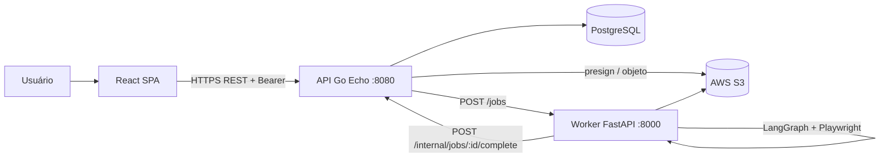

# TDD — Content Creator Agent

| Campo | Valor |
| ----- | ----- |
| Tech Lead | Solo Dev |
| Time | Solo |
| Epic/Ticket | — |
| Figma/Design | `docs/ui-guidelines.md` + `docs/ui/*.png` |
| Status | Alinhado ao repositório e a `docs/ARCHITECTURE.md`, `docs/INTEGRATIONS.md`, `docs/STRUCTURE.md`, `docs/TESTING.md` |
| Criado em | 2026-04-10 |
| Última revisão | 2026-04-25 |

Este documento descreve o desenho técnico. Detalhe de arquivos e localização estão em **`docs/ARCHITECTURE.md`**, **`docs/STRUCTURE.md`** e **`docs/INTEGRATIONS.md`**.

---

## Contexto

O **Content Creator Agent** é uma plataforma web que apoia a criação de posts para o **Instagram** com LLMs, respeitando identidade visual e diretrizes de comunicação. O ciclo central são **`chats`**: o usuário envia mensagens, o sistema gera slides (JPEG) armazenados no **S3**, com trabalho assíncrono orquestrado entre a **API Go** e o **worker Python (LangGraph + Playwright)**.

**Stakeholders:** criadores de conteúdo, social media e pequenos negócios que precisam de consistência visual no Instagram.

---

## Definição do problema e motivação

(Objetivo de produto inalterado: inconsistência de marca, *prompts* subóptimos, falta de histórico reutilizável — ver `docs/PRD.md` para a visão de negócio.)

---

## Escopo

### Em escopo (V1 — alinhado ao código)

- Autenticação: cadastro (chave de segurança exibida uma vez), login, *refresh* (cookie HttpOnly), recuperação de senha.
- **Perfil na aplicação:** `GET`/`PUT /profile` com textos de auditoria e marca; `POST`/`DELETE` referências de design (S3); `GET /setup/status` antes de enviar mensagens.
- Chat: CRUD de chats, limite de **5** chats por usuário com remoção do mais antigo ao criar o 6.º.
- **Geração assíncrona:** `POST /chats/:id/messages` → **202** + `jobId`; *polling* `GET /chats/:id/jobs/:jobId/status`; conclusão via *callback* do worker para a API.
- Pipeline no **worker:** LangGraph (perfil, descrição de referências, otimização de *brief*, HTML de slides, validação, JPEG via Playwright, *upload* S3, *finalize*).
- Download de arquivos e ZIP; telas de histórico e chat na SPA (`apps/web`).
- *Cron* de sumarização diária na **API** (OpenAI), se `OPENAI_API_KEY` estiver definida.
- Segurança: *rate limit*, sanitização, CORS explícito, medidas descritas em `docs/CONCERNS.md` (dívidas técnicas conhecidas).

### Fora de escopo (V1)

- Publicação direta no Instagram.
- Outras redes como alvo de primeiro nível.
- *Analytics* de performance de posts, *billing* / *multi-tenant* avançado.
- Tradução da UI para várias línguas (o produto assume PT no contexto atual).

### Futuro (V2+)

- *Onboarding* ainda mais integrado a capturas `instagram-audits/`, automação adicional, Redis para *rate limit* multi-instância, *refresh token* com rotação (ver preocupações em `docs/CONCERNS.md`).

---

## Solução técnica

### Visão geral

Monorepo: **React (Vite)** ↔ **API Go (Echo)** ↔ **PostgreSQL** e **S3**; a API despacha trabalhos longos para o **worker Python (FastAPI + LangGraph + Playwright)**. Não existe `export-slides.js` a correr dentro do *binary* Go: a renderização para JPEG acontece no **container do worker** (`docs/ARCHITECTURE.md`).

| Componente | Responsabilidade |
| ---------- | ---------------- |
| **SPA** | Autenticação, perfil, chat, histórico, *poll* de *jobs* |
| **API Go** | JWT, CRUD, perfis, S3 (presign, ZIP), criação de *jobs*, despacho HTTP ao worker, *callback* `/internal/jobs/:id/complete`, sumarizador |
| **Worker Python** | Cadeia LangGraph, OpenAI, Playwright, *upload* para S3, *callback* à API |
| **S3** | JPEGs e imagens de referência |
| **PostgreSQL** | Usuários, chats, conteúdo, imagens, *jobs*, resumos, perfis e referências |

**Diagrama (alinhado a `docs/ARCHITECTURE.md`):**



### Fluxo — criação de conteúdo (mensagem → slides)

1. Usuário com perfil configurado envia `POST /chats/:id/messages` (corpo de texto; referências já estão no perfil/S3).
2. A API valida JWT, *rate limit* de LLM, perfil completo (`SETUP_REQUIRED` se faltar auditoria/marca), cria `ChatContent` do usuário, registro de `Job` e envia `POST {WORKER_URL}/jobs` com *payload* documentado em `docs/INTEGRATIONS.md`.
3. Resposta **202** com `jobId` (não devolve a mensagem do assistente no mesmo *request*).
4. O worker executa o grafo; no fim chama `POST /internal/jobs/:id/complete` com *artifacts* (chaves S3 `slides/{jobId}/...`).
5. A API grava resposta do assistente e imagens, marca o *job* como concluído.
6. O cliente usa `GET /chats/:id/jobs/:jobId/status` até `done` ou `failed` e atualiza o fio do chat.

Modelos OpenAI no worker: ver **`docs/INTEGRATIONS.md`** (p.ex. `gpt-4o-mini` / `gpt-4o` nos nós atuais). *Max tokens* e *prompts* em `apps/worker/`.

### Fluxo — sumarização

1. *Cron* na API (UTC), expressão `SUMMARIZE_CRON`, por predefinição `0 2 * * *`.
2. Orquestração em `apps/api/internal/summarizer/`, cliente `sashabaranov/go-openai` (modelo no código, p.ex. `GPT4oMini`).
3. Orçamento de tempo por execução e escrita em `chat_content_resume`.

### Fluxo — “*setup*”

- O *gate* de negócio é **perfil com `audit_text` e `brand_text` preenchidos** (e opcionalmente referências), não a existência de uma árvore de pastas `instagram-audits/` no servidor da API.
- A pasta `instagram-audits/` no repositório apoia o *workflow* de auditoria e *skills* (`map-instagram-profile`); o usuário copia conteúdo para a tela de perfil. Ver `docs/PRD.md` e `docs/STRUCTURE.md`.

### Rotas HTTP (resumo; autoridade: `apps/api/cmd/server/main.go`)

**Público / *health*:** `GET /health`

**Auth** (*rate limit* por IP: `POST /auth/register`, `login`, `refresh`, `recover-password`).

**Protegido (JWT):** `GET /me`; `GET|POST|GET|DELETE /chats` e `chats/:id`; `GET /chats/:id/files`, `.../files/:fileId`, `.../files/download`; `GET /setup/status`; `GET|PUT /profile`; `POST /profile/references`, `DELETE /profile/references/:id`.

**LLM** (*rate limit* por usuário): `POST /chats/:id/messages` (**202**), `GET /chats/:id/jobs/:jobId/status`; `GET /api/llm/ready`.

**Interno (worker, chave partilhada):** `POST /internal/jobs/:id/complete`

**Exemplo assíncrono** — criar mensagem (contrato lógico):

```http
POST /chats/{chatId}/messages
Authorization: Bearer <access>
Content-Type: application/json

{ "content": "Carrossel sobre produtividade…" }
```

```http
HTTP/1.1 202 Accepted
{ "jobId": "<uuid>" }
```

*Refresh:* o *refresh token* via cookie HttpOnly; o detalhe do corpo de `POST /auth/refresh` segue a implementação em `apps/api/internal/auth/` (não supor resposta 200 com mensagem do assistente no `POST` de mensagem — isso acontece após o *job*).

### Modelo de dados (alinhado a `apps/api/internal/db/models.go`)

- **users** — `id` (UUID), `email`, *hashes*, `role`, *timestamps*.
- **chats** — `user_id`, `post_type` (`single` | `carousel`), `title` opcional.
- **chat_content** — `chat_id`, `role` (`user` | `assistant`), `content`.
- **chat_content_image** — `s3_key`, `url` (presign ou URL servida; TTL presign: ver `docs/CONCERNS.md` e `docs/INTEGRATIONS.md`), `slide_number`.
- **chat_content_resume** — resumo, `last_content_at`, `summarized_at`.
- **jobs** — `chat_id`, `user_id`, `status` (*pending* / *processing* / *done* / *failed*), `error_msg` opcional.
- **user_profiles** — `audit_text`, `brand_text` por usuário.
- **user_profile_references** — chaves S3 e ordenação.

Migrações: **SQL** numeradas em `apps/api/internal/db/migrations/` (golang-migrate).

### Integrações externas

Fonte: **`docs/INTEGRATIONS.md`** (S3, OpenAI no worker e na API, contratos `DispatchPayload` e `CompleteBody`, Playwright, Compose).

### Segurança (resumo; detalhe em secções anteriores do histórico + `docs/CONCERNS.md`)

- Access token curto (memória no cliente), refresh em cookie HttpOnly, CORS, cabeçalhos de segurança.
- *Rate limit* em memória (ver limites em `docs/ARCHITECTURE.md` e implicação multi-réplica em `docs/CONCERNS.md`).
- Palavra-passe: HTTPS + bcrypt; extensão RSA no cliente comentada em `apps/web/src/lib/crypto.ts`.

### Testes (autoridade: `docs/TESTING.md`)

- Go: `go test ./...` com SQLite em *unit*; `go test -tags=integration` com Postgres.
- *E2E* raiz: `tests/e2e/` (pytest + stack Compose).
- *Screenshots* web: `apps/web` Playwright `npm run screenshots`.
- *Coverage/*CI: o que o repositório tiver de configurado; `docs/CONCERNS.md` regista *gaps* históricos de CI.

---

## Riscos (atualizados; ver também `docs/CONCERNS.md`)

| Risco | Notas / mitigação |
| ----- | ----------------- |
| Indisponibilidade OpenAI | Tratamento de erros no worker e API; *jobs* `failed` com mensagem |
| Custos de API | Sumarização compacta; `max_tokens` nos nós; monitorização manual |
| *Rate limit* em memória | Não partilhado entre réplicas; Redis como evolução |
| URLs S3 presign expiradas na BD | Documentado em `CONCERNS` — preferir *presign* à leitura ou só `s3_key` |
| *Jobs* presos em *processing* | Crashes do worker; falta *timeout* de reconciliação (ideia em `CONCERNS`) |
| Playwright no worker | *Dockerfile* do worker com Chromium; falha de render → *job* falhado, não a API a invocar *script* Node na API |

---

## Plano de implementação (histórico)

As fases abaixo descrevem a ordem lógica de entrega. O estado concreto do código está em `apps/*`; não substitui a leitura de `docs/STRUCTURE.md`.

| Fase | Conteúdo |
| ---- | -------- |
| Base | API Go, migrations, auth |
| Core | Chats, S3, *jobs*, despacho ao worker, *callback* |
| Worker | LangGraph, Playwright, integração OpenAI |
| Web | *SPA*, *poll* de *jobs*, perfis |
| *Cron* | Sumarizador |
| *QA* | *Tests* de `docs/TESTING.md` |

---

## Monitorização, *rollback* e métricas

- Operação: `docs/RUNBOOK.md` (*logs* por `job_id`, *health*).
- Métricas e alertas abaixo são **diretrizes**; a stack de observabilidade depende do *deploy*.

Mantém-se como referência a tabela de métricas e o plano de *rollback* do *draft* original, ajustada mentalmente a três serviços (api, worker, *frontend* estático).

---

## Decisões e alternativas (atualizadas)

- **API em Go (Echo) + *worker* em Python:** separação de orquestração REST e pipeline LLM/Playwright, alinhada ao monorepo atual.
- **PostgreSQL + GORM + migrações SQL.**
- **S3** para *blobs*.

Referência cruzada: **`docs/ARCHITECTURE.md`** (substitui documentos de arquitetura descontinuados com nomes antigos).

---

## Questões (estado)

| # | Tema | Síntese |
| - | ---- | ------- |
| 1 | Limite de 5 chats | Remoção automática do mais antigo ao criar o 6.º; usuário pode apagar antes. |
| 2 | Redis | Opcional; *V1* com *rate limit* em memória. |
| 3 | *Refresh* | HttpOnly *cookie* + *access* em memória. |
| 4 | Geração de *slides* | LLM gera **HTML** (blocos); **Playwright** no **worker** exporta **JPEG** 768×1376 (qualidade ~92). Modelos: ver `docs/INTEGRATIONS.md` (não DALL·E). |
| 5 | *Tokens* | *Max tokens* no gerador p.ex. 4000 no nó de *slides*; afinar com dados reais. |

---

*Documento alinhado a `docs/PRD.md`, `docs/ARCHITECTURE.md`, `docs/INTEGRATIONS.md`, `docs/STACK.md`, `docs/STRUCTURE.md`, `docs/TESTING.md`, `docs/CONCERNS.md` e `docs/RUNBOOK.md`.*
