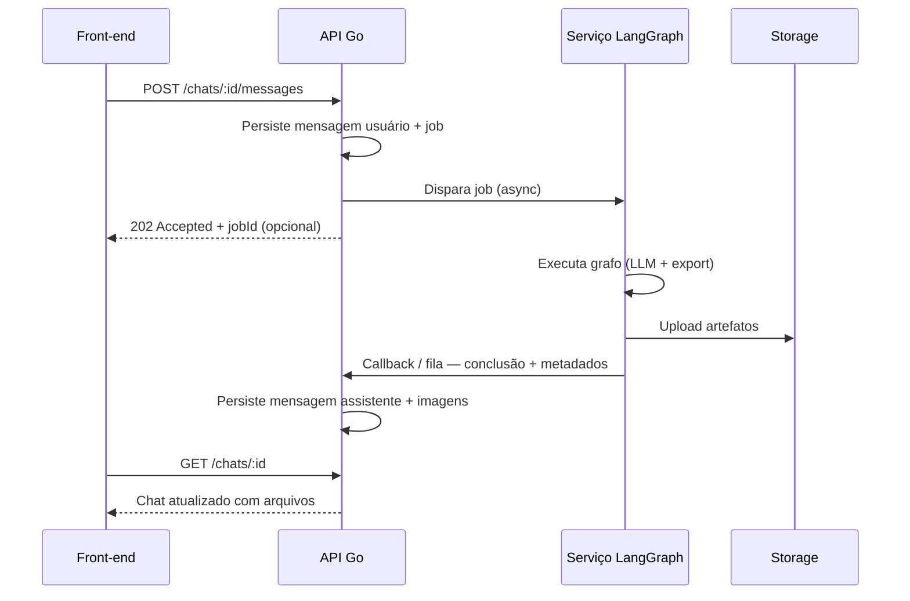
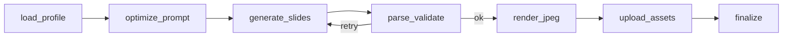

# Arquitetura — API Go + LangGraph como motor de processamento

| Campo | Valor |
| ----- | ----- |
| Tipo | Proposta / referência de arquitetura |
| Status | Draft |
| Última revisão | 2026-04-12 |

---

## Objetivo

Descrever uma separação em que o **backend Go** concentra-se em **API voltada ao front-end** (CRUD, autenticação, metadados, entrega de arquivos), enquanto um **serviço Python com LangGraph** executa o **pipeline de geração de conteúdo** (brief → HTML de slides → rasterização → armazenamento).

Esta divisão permite evoluir orquestração, prompts e ramificações do fluxo no ecossistema LangGraph sem acoplar essa complexidade ao binário Go.

---

## Princípios

1. **Go como borda HTTP**: o navegador e apps clientes falam apenas com a API Go (JWT, rate limit, contratos estáveis).
2. **LangGraph como domínio de processamento**: estado explícito entre nós, retries, ramificações e integração com ferramentas (LLM, Playwright, storage) ficam no serviço Python.
3. **Processamento assíncrono**: geração + export visual costuma exceder o tempo confortável para uma única requisição síncrona; o fluxo recomendado é job + notificação de conclusão (webhook interno, fila ou polling de status).
4. **Contrato explícito** entre Go e Python: payloads versionados, idempotência e autenticação de serviço a serviço.

---

## Papéis por camada

| Camada | Responsabilidade principal |
| ------ | -------------------------- |
| **Front-end** | UX; chama apenas a API Go; exibe status de processamento e arquivos quando prontos. |
| **Go (API)** | CRUD de chats e mensagens, JWT, limites, listagem e download de arquivos, disparo de jobs de geração, persistência autoritativa do modelo de dados exposto ao cliente. |
| **Python (LangGraph)** | Pipeline completo de geração: carregar contexto de perfil, otimizar prompt, gerar HTML dos slides, validar/parsear, exportar JPEG (ex.: Playwright), enviar artefatos ao storage. |
| **Storage (ex.: S3)** | Blobs finais; URLs assinadas ou proxy podem ser responsabilidade do Go para o cliente. |

O Go **não** precisa embutir LangChain/langchaingo para slides neste desenho; a lógica de agente vive no serviço Python.

---

## Fluxo ponta a ponta

1. O usuário envia uma mensagem: `POST /chats/:id/messages` (Go).
2. Go valida autenticação e posse do chat, persiste a **mensagem do usuário** e registra um **job** (ou estado `processing`) associado ao chat.
3. Go **dispara** o trabalho assíncrono para o serviço Python, por HTTP ou fila (SQS, Redis, NATS, etc.), com identificadores e payload mínimo necessário.
4. O **grafo LangGraph** executa os nós até conclusão ou falha tratável.
5. Ao finalizar, o Python **notifica** o Go (webhook interno protegido, mensagem em fila consumida pelo Go, ou outro padrão acordado) com o texto da resposta do assistente e referências aos arquivos (ou o próprio Go só persiste após upload confirmado — ver seção de persistência).
6. O front obtém o resultado via `GET /chats/:id` ou assinatura em tempo real, conforme o produto definir.

---

## Grafo LangGraph (referência)

### Estado compartilhado

O estado (por exemplo `TypedDict` ou modelo Pydantic) pode incluir, entre outros:

| Campo | Descrição |
| ----- | --------- |
| `user_id` | Identificador do usuário (UUID). |
| `chat_id` | Identificador do chat (UUID). |
| `job_id` | Correlação com o job no Go (idempotência e tracing). |
| `raw_message` | Texto enviado pelo usuário. |
| `profile_text` | Contexto AUDIT/BRAND (ou referência para carregar). |
| `optimized_brief` | Saída do passo de otimização de prompt. |
| `slides_html` | Lista de `{ name, html }` após parse. |
| `errors` | Erros parciais para retry ou falha final. |
| `artifact_paths` ou `s3_keys` | Resultado de export e upload. |

### Nós sugeridos

| Nó | Função |
| -- | ------ |
| `load_profile` | Monta o contexto de perfil (dados inline no payload do Go, leitura de path compartilhado, ou objeto no S3 referenciado pelo `user_id`). |
| `optimize_prompt` | Equivalente ao otimizador de prompt atual — chamada LLM com brief + perfil. |
| `generate_slides` | Chamada(s) LLM com o skill de slides; saída alinhada ao formato com marcadores `###SLIDE_FILE:...###` (ou contrato JSON se ambos os lados migrarem juntos). |
| `parse_and_validate` | Extrai slides, valida HTML mínimo; pode **retornar** ao nó de geração em caso de erro. |
| `render_to_jpeg` | Rasterização (ex.: Playwright headless) a partir dos HTMLs. |
| `upload_assets` | Envio ao object storage. |
| `finalize` | Monta o payload de conclusão para o Go. |

### Diagrama do grafo (lógico)

Ramificações adicionais (futuro): revisão humana, múltiplos modelos, ou nó que solicita **URLs pré-assinadas** ao Go antes do upload.

---

## Contrato Go ↔ Python

### Entrada (Go → Python)

Incluir pelo menos:

- `chat_id`, `user_id`, `job_id`
- Texto da mensagem do usuário
- **Perfil**: texto completo, URI, ou chave de objeto no storage já validada pelo Go
- Versão do schema do payload (`contract_version`) para evolução segura

### Saída (Python → Go)

- Texto da mensagem do assistente (resumo, ex.: “Carrossel gerado com N slide(s).”)
- Lista ordenada de artefatos: nome lógico, `s3_key` ou equivalente, `slide_number`
- Status: `success` | `failed` + código/mensagem para o cliente

### Segurança

- O serviço Python **não** deve ser exposto diretamente ao browser.
- Comunicação Go ↔ Python: mTLS, API key de serviço, ou rede privada; rotas internas apenas.

---

## Persistência e responsabilidades

| Abordagem | Descrição |
| --------- | --------- |
| **A — Python chama API interna Go** | O Python envia o resultado para `POST /internal/...` (ou similar) com credencial de serviço; o Go continua dono do schema e das transações. |
| **B — Fila de eventos** | Python publica evento “geração concluída”; worker Go persiste. Desacopla, mas exige contrato de evento e consumidor idempotente. |
| **C — Python grava direto no DB** | Possível, mas acopla o Python ao modelo e migrações do Postgres; exige disciplina extra. |

Recomendação típica: **A ou B** para manter o Go como única fonte de verdade para o modelo exposto ao front.

### Idempotência

Retries do grafo ou reenvio de jobs **não** devem duplicar mensagens ou arquivos no mesmo `chat_id` + `job_id`. O Go deve tratar `job_id` como chave idempotente na conclusão.

### Observabilidade

Propagar `job_id` (e opcionalmente `trace_id`) em logs do Go e traces do LangGraph para depuração ponta a ponta.

---

## Relação com o código atual

Hoje o repositório implementa o pipeline (otimização → `SlideGenerator` → Playwright → S3) **dentro do processo Go** (`PostMessage`). Esta arquitetura documentada é uma **evolução opcional**: migrar o motor para LangGraph implica extrair esse pipeline para o serviço Python e ajustar o Go para disparo assíncrono + persistência via contrato interno, conforme as seções acima.

---

## Referências internas

- Fluxo síncrono atual de mensagens e slides: `backend/internal/chat/post_message.go`, `backend/internal/agent/slide_generator.go`
- Decisão de stack no TDD (API Go vs agente): `docs/TDD.md` — seção “Alternativas Consideradas / Backend”
