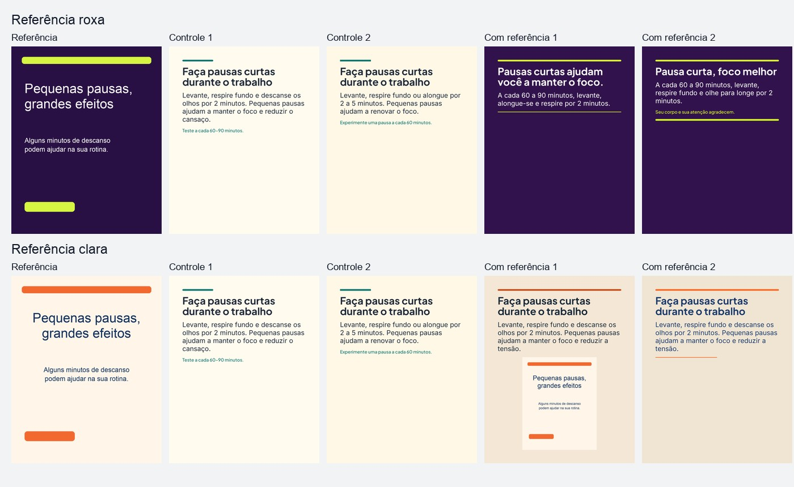
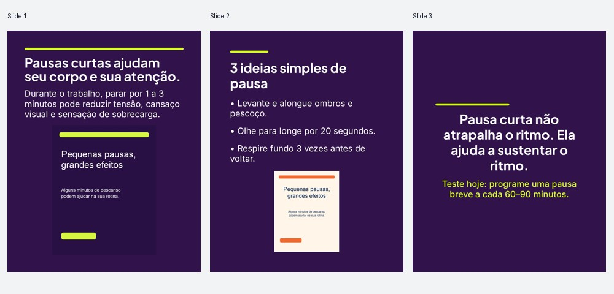

# Ensaio sintético de fidelidade visual V2 — 23/11/2026

## Resultado

No ensaio após ajuste do prompt, as quatro amostras com referências tiveram
destaques na cor aproximada e um destaque no início do fluxo. O layout `hero`
colocou o primeiro destaque próximo ao topo. A segunda barra continuou próxima ao
texto, em vez de ocupar a região inferior das referências; as proporções e a
composição não foram reproduzidas integralmente. Os dois controles também tiveram
um destaque no início, portanto sua posição isoladamente não demonstra influência
das referências. Uma amostra clara incorporou a própria referência como imagem.

[Comparativo anterior](comparativo.jpg) · [Medições após ajuste](apos-ajuste/medicoes.csv) ·
[Snapshots resumidos após ajuste](apos-ajuste/resultados.json) ·
[Medições anteriores](medicoes.csv)

### Carrossel com referências conflitantes

Um carrossel adicional de três slides recebeu simultaneamente as referências roxa
e clara. A saída usou fundo roxo e acento verde nos três layouts e uma decoração por
slide. As próprias referências foram incorporadas como imagens nos dois primeiros
slides, incluindo seus textos sintéticos; esse comportamento merece revisão de
produto antes do aceite. Não foi possível verificar como o modelo classificou o
conflito na direção temporária apenas pelo snapshot final.

[Documento do carrossel](carrossel/documento.json) · [Slide 1](carrossel/slide-1.jpeg) ·
[Slide 2](carrossel/slide-2.jpeg) · [Slide 3](carrossel/slide-3.jpeg)

### Referências fornecidas pelo usuário

As duas imagens fornecidas foram usadas, com autorização, em um ensaio real
posterior. A [avaliação resumida](referencias-fornecidas.md) registra os resultados;
originais e imagens geradas permanecem somente no ambiente local. Fotografia,
textura de papel, recortes, ilustrações e tipografia variada excedem o catálogo de
objetos editáveis atual.

| Referência | ΔE76 do fundo após ajuste | ΔE76 do título após ajuste | Menor ΔE76 do acento nas decorações |
| --- | --- | --- | --- |
| Roxa | 4,7 / 4,7 | 0,0 / 0,0 | 10,8 / 10,8 |
| Clara | 5,6 / 6,5 | 19,2 / 6,2 | 12,5 / 7,1 |

Os valores são calculados das cores resolvidas no snapshot; ΔE76 menor indica
maior proximidade, mas não foi definido limiar de aprovação. O contraste mínimo
de texto calculado nos quatro snapshots com referência variou de 8,93:1 a
15,86:1. O JPEG foi inspecionado visualmente, mas não houve auditoria abrangente
de pixels, antialiasing ou acessibilidade em dispositivos.

## Método e limites

- API, worker, PostgreSQL e Chromium rodaram em stack Docker isolada; OpenAI e AWS
  S3 foram reais. Perfil, textos e imagens eram sintéticos. Foram gerados dois
  controles e duas amostras para cada referência, em cada rodada; é uma avaliação
  exploratória, sem inferência estatística de fidelidade ou aprovação de marca.
- Na primeira rodada, as quatro amostras com referências escolheram `quote` e as
  barras ficaram centralizadas junto ao texto. Após incluir no prompt a diferença
  de posicionamento entre layouts, as quatro amostras com referências escolheram
  `hero`, com a primeira barra no topo. A segunda rodada também mudou os controles
  para `hero`; as chamadas são não determinísticas e a amostra é pequena.
- As amostras claras da primeira rodada foram retomadas após ajuste de contraste;
  por isso ela combina resultados gerados antes e depois desse ajuste. A segunda
  rodada foi gerada com o prompt de posicionamento e retentativa de contraste.
  São versões diferentes do prompt e não há pareamento estatístico entre imagens.
- Uma tentativa inicial identificou saída inválida para canto de linha. Após
  explicitar a regra no prompt, uma tentativa com referência clara falhou por
  contraste; outra esgotou as tentativas de schema/contraste. Essas falhas são
  parte do resultado e não devem ser omitidas do cálculo futuro de confiabilidade.
  A retentativa agora informa ao modelo os dois requisitos sem modificar
  silenciosamente o snapshot; após o ajuste, as seis amostras da segunda rodada
  foram concluídas. Houve ainda uma falha inicial de configuração do callback na
  stack de teste, corrigida antes de retomar o ensaio.
- As referências e os jobs do ensaio foram criados para o teste e removidos; os
  artefatos locais publicados neste diretório são sintéticos. A direção temporária
  de visão não foi persistida, portanto não se pode afirmar como o modelo
  classificou cada detalhe observado ou incerto.
- [Métricas agregadas](metricas.json) registram 13 jobs estruturados concluídos e
  dois falhos no período preservado da API, com p95 de 43.501 ms. É uma amostra
  pequena e inclui diferentes rodadas e retentativas. O worker foi recriado durante
  o ensaio; seus eventos cobrem uma janela menor e não podem ser comparados
  diretamente com os totais da API. Custos e tokens não foram medidos.

## Pendências para aceite

Concluir a revisão humana das amostras com referências autorizadas, decidir a
política de incorporação das imagens e acordar metas de qualidade, custo,
latência e falhas com base em medições. Concluir a reconciliação da T18 com S3
real e ensaiar coleta e rollback no destino antes de ativar a V2 em tráfego.
