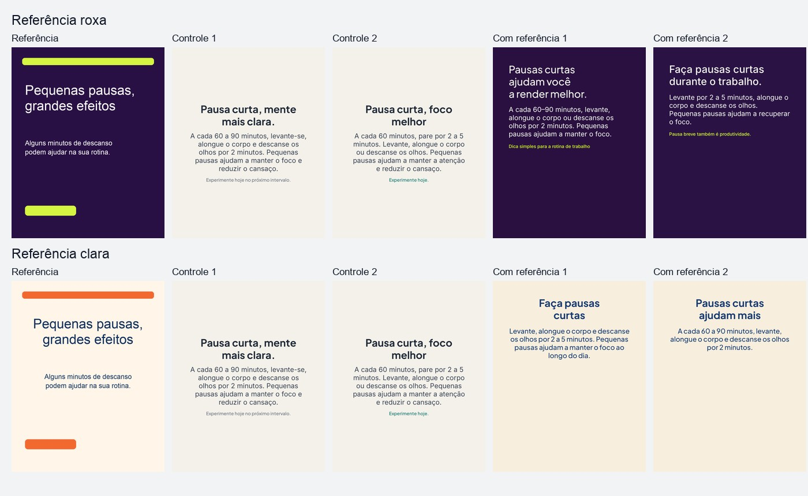

# Ensaio comparativo de referências visuais — 23/11/2026

## Resultado

As referências influenciaram as cores e a composição em ambas as condições, com limites visíveis. Nas duas amostras com a referência roxa, o fundo e o destaque ficaram próximos da referência e o texto passou a ser alinhado à esquerda. Nas duas com a referência clara, o fundo e o texto azul foram aproximados e o texto permaneceu centralizado, mas o destaque laranja não apareceu.

As barras coloridas presentes nas referências não foram reproduzidas. O fluxo estruturado V1 tem layouts e elementos limitados; não se esperava uma cópia literal. Esta é uma avaliação exploratória de duas amostras por condição, não uma taxa de acerto nem uma aprovação de marca.



[Referência roxa](referencia-roxo.png) · [Roxo 1](roxo-1.jpeg) · [Roxo 2](roxo-2.jpeg)  
[Referência clara](referencia-claro.png) · [Claro 1](claro-1.jpeg) · [Claro 2](claro-2.jpeg)  
[Controle 1](controle-1.jpeg) · [Controle 2](controle-2.jpeg) · [Medições completas](medicoes.csv) · [Estilos dos snapshots](resultados.json)

## Método

- Fluxo `structured_v1`, API, worker e PostgreSQL em Docker isolado, AWS S3 e OpenAI reais. Modelos de visão e geração configurados: `gpt-5.4`; Playwright `1.65.2`.
- Um post único por geração, com o mesmo pedido: “Crie um post único com uma dica breve sobre fazer pausas durante o trabalho.” Todos receberam os mesmos textos sintéticos de perfil e marca, sem prescrição de cores.
- Duas gerações sem imagem de perfil servem de controle comum; duas usaram a referência roxa e duas a clara. As referências foram desenhadas para o ensaio, com fundo sólido, texto e barras de destaque.
- Os prompts são iguais, mas o modelo é não determinístico. Por causa de uma resposta HTTP 429 durante o polling, a primeira amostra roxa foi recuperada após a conclusão do job. A segunda foi gerada com outra conta sintética e uma nova cópia da mesma referência; as duas amostras claras usaram a mesma referência e puderam compartilhar o resumo em cache.
- Cada JPEG e snapshot foi obtido após o job concluir. Os chats, referências e objetos temporários do S3 foram removidos. A stack foi descartada; as imagens locais deste relatório são sintéticas.

## Comparação objetiva

As cores abaixo são as declaradas nos snapshots, não uma extração exaustiva dos pixels. A distância **ΔE76** compara cores em CIELAB/D65: quanto menor, mais próximas são as cores. Não foi definido um limite de aprovação. A cor de acento é comparada à cor de texto mais próxima de cada amostra; isso não mede formas ou proporções de área.

| Referência | Alvo: fundo / título / acento | Amostras | ΔE fundo | ΔE título | Menor ΔE do acento nos textos | Alinhamento do título |
|---|---|---|---:|---:|---:|---|
| Roxa | `#291044` / `#FFFFFF` / `#D5F542` | Controles 1 e 2 | 93,4 | 84,4 | 101,7 e 93,3 | Centro |
| Roxa | Mesmos alvos | Roxo 1 e 2 | 2,0 e 1,1 | 3,2 e 3,2 | 12,3 e 9,3 | Esquerda |
| Clara | `#FFF5E9` / `#12315D` / `#F26930` | Controles 1 e 2 | 4,0 | 20,6 | 82,0 e 89,6 | Centro |
| Clara | Mesmos alvos | Claro 1 e 2 | 3,7 | 8,0 | 106,1 | Centro |

O controle já tinha fundo claro e texto centralizado, então esses aspectos da referência clara, isoladamente, não demonstram influência. A aproximação do azul é mais evidente no snapshot; as duas amostras claras não incluíram cor de texto próxima ao laranja.

Os títulos tinham contraste calculado no snapshot entre **9,57:1 e 15,67:1** nas amostras com referência. Isso não é uma auditoria de acessibilidade do JPEG: o renderizador pode ajustar cores ao renderizar, e tamanho efetivo, antialiasing e demais textos também precisam ser avaliados. Um texto pequeno do controle 1 tinha contraste declarado de **4,29:1**; a cor efetivamente renderizada não foi medida neste ensaio.

## Avaliação visual

- **Paleta:** forte aproximação na condição roxa. Na clara, fundo e azul foram aproximados, mas o acento laranja foi omitido.
- **Hierarquia e alinhamento:** as amostras roxas passaram de texto centralizado nos controles para texto à esquerda, como a referência. As claras ficaram centralizadas, mas os controles também eram centralizados.
- **Composição:** as referências separam os blocos em regiões amplas e incluem barras. Os resultados agruparam o texto na parte superior e deixaram grande área vazia abaixo; as barras não apareceram.
- **Tipografia:** o snapshot escolheu Inter e/ou Plus Jakarta Sans, conforme o catálogo V1. Isso não garante reprodução da fonte da referência. A avaliação de identidade tipográfica exata não foi realizada.
- **Legibilidade:** títulos visualmente distintos e sem cortes aparentes nas imagens inspecionadas. Não houve auditoria completa de acessibilidade nem avaliação em dispositivos móveis.
- **Imagens e coesão:** nenhuma amostra incorporou a referência como asset. Foram criados posts únicos, portanto coesão entre slides não foi avaliada.

## Limitações e próximos passos

O teste confirma um efeito perceptível para estas referências e este pedido, mas não estabelece consistência para outras marcas, fotografias, outros pedidos ou carrosséis. O resumo visual é produzido por outro modelo e pode variar; em cache, chamadas seguintes podem reutilizá-lo. Os textos nos slides são saídas sintéticas da LLM e não foram revisados para publicação.

Para aceite, repetir com imagens e orientações de uma marca real, exemplos de múltiplos slides e mais amostras; avaliar fidelidade e legibilidade com o responsável. Se as barras e outros detalhes forem requisitos, será necessário verificar ou ampliar o catálogo do renderizador antes de exigir sua reprodução.

## Reprodução

Com uma stack híbrida **isolada**, S3 não produtivo e credenciais configuradas, execute a partir da raiz. O Python local precisa de `httpx`, `boto3`, `python-dotenv` e `Pillow`; a geração das referências usa Arial quando disponível ou DejaVu Sans como alternativa. Os comandos geram chamadas reais à LLM e ao S3, com custo; o ensaio cria e remove seus próprios chats e objetos. O diretório de saída deve ser novo.

```powershell
python tests/visual_reference_eval/run.py --api-url http://127.0.0.1:PORTA --output .local/ensaio-visual
python tests/visual_reference_eval/analyze.py .local/ensaio-visual
```

Para prosseguir com amostras já registradas após interrupção, `run.py` aceita `--resume`. Se um job ainda estiver ativo ou houver falha de rede antes da limpeza, preserve a stack e investigue os dados pendentes antes de retomá-lo ou removê-la. Não use uma API de produção.
